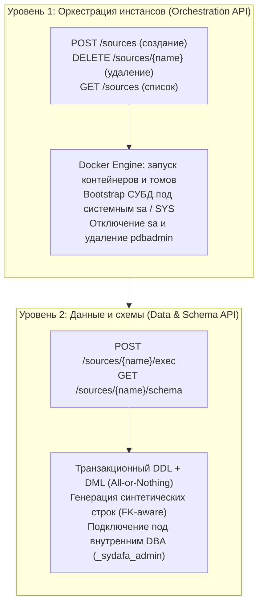

# sydafa

**sydafa** (Synthetic Data Factory & DB Orchestrator) — автономный сервис для оркестрации реляционных СУБД-источников, декларативного управления схемами данных и генерации синтетических данных.

Сервис предназначен для изолированного тестирования ETL/ELT-пайплайнов (Spark, Airflow, dbt), озер данных (Iceberg, Delta Lake) и витрин данных без необходимости ручного развертывания и ручного наполнения тестовых реляционных СУБД.

---

## 1. Архитектура: Два уровня абстракции

Система строго разделена на два изолированных уровня с разграничением привилегий и обязанностей:



1. **Уровень 1: Orchestration API (Инфраструктура)**
   - Отвечает за жизненный цикл контейнеров Docker, именованные тома данных и сетевые интерфейсы.
   - Однократно выполняет вендорный bootstrap СУБД под правами системного администратора (`sa` в MSSQL, `SYS as SYSDBA` в Oracle): создает рабочую базу данных `sydafa`, настраивает учетные записи, после чего навсегда отключает `sa` (`ALTER LOGIN [sa] DISABLE`) и удаляет `pdbadmin`.
2. **Уровень 2: Data & Schema API (Данные и транзакции)**
   - Отвечает за транзакционное создание таблиц, миграции структуры и генерацию строк.
   - Работает исключительно внутри рабочей БД `sydafa` под сгенерированным внутренним DBA (`_sydafa_admin_*`). У него нет и не должно быть доступа к Docker Socket или к мастер-базам сервера (`master`, `FREE`).

---

## 2. Модель доступа и безопасность

| Учетная запись | Логин | Пароль | Роль и привилегии | Назначение |
| :--- | :--- | :--- | :--- | :--- |
| **Публичный читатель** | `sydafa` | `sydafa` | Только чтение (`SELECT`) | Spark, Airflow, Trino, DBeaver |
| **Внутренний DBA** | Случайный (напр. `_sydafa_admin_3f2a`) | Случайный | DBA внутри базы `sydafa` | **Только ядро sydafa** (скрыт в `/state/secrets.json`) |
| **Вендорные админы** | `sa`, `pdbadmin` | — | Заблокированы | `sa` отключен (`DISABLE`), `pdbadmin` удален |

- Имя рабочей базы данных: **`sydafa`**.
- Единые реквизиты читателя для любых проверок, пайплайнов и DBeaver: логин **`sydafa`**, пароль **`sydafa`**.
- Изменить структуру базы напрямую через DBeaver невозможно: учетка `sydafa` имеет права строго на чтение, а пароль суперпользователя знает только сам сервис.

---

## 3. Сетевая модель и порты

### Именование контейнеров и DNS
Каждый инстанс получает стандартизированное сетевое имя по строгой маске:
`sydafa-<тип СУБД>-<имя инстанса>-source`

Примеры:
- Инстанс `billing` типа `mssql` -> `sydafa-mssql-billing-source`
- Инстанс `crm` типа `oracle` -> `sydafa-oracle-crm-source`
- Инстанс `erp` типа `oracle` -> `sydafa-oracle-erp-source`

В тестовом контуре добавляется изолирующий префикс: `sydafa-test-mssql-billing-source`.

### Почему одинаковые внутренние порты в Docker — это норма
Внутри Docker-сети каждый контейнер представляет собой отдельный виртуальный сетевой хост со своим собственным IP-адресом. Поэтому:
- Все контейнеры Oracle слушают стандартный внутренний порт **`1521`**.
- Все контейнеры MSSQL слушают стандартный внутренний порт **`1433`**.
Конфликта портов не возникает: сервисы стенда (Spark, Airflow) обращаются к ним по DNS-именам: `sydafa-oracle-crm-source:1521` и `sydafa-oracle-erp-source:1521`.

### Внешние порты на хост-машине (`SYDAFA_EXT_PORT_<NAME>`)
Коллизия портов возможна только на сетевом интерфейсе вашего компьютера (ноутбука). Чтобы открыть доступ к базам из DBeaver, внешние порты хоста задаются индивидуально в переменных окружения сервиса `sydafa` в `docker-compose.yaml`:
```yaml
environment:
  - SYDAFA_EXT_PORT_BILLING=14330   # пробросить на Mac порт 14330 для инстанса billing
  - SYDAFA_EXT_PORT_CRM=15211       # пробросить на Mac порт 15211 для инстанса crm
  - SYDAFA_EXT_PORT_ERP=15212       # пробросить на Mac порт 15212 для инстанса erp
```
Если для инстанса переменная не задана, внешний порт не открывается, и база работает изолированно внутри Docker-сети.

---

## 4. Декларативный манифест `init.json` (Seed)

Файл `init.json` монтируется в контейнер sydafa (`/app/config/init.json:ro`) и объявляет состав баз и начальное наполнение:

```json
{
  "sources": {
    "billing": {
      "type": "mssql",
      "operations": [
        {"op": "create_schema", "name": "demo"},
        {
          "op": "create_table",
          "schema": "demo",
          "name": "customers",
          "primary_key": ["customer_id"],
          "columns": [
            {"name": "customer_id", "type": "bigint", "generator": {"kind": "sequence"}},
            {"name": "name", "type": "string", "generator": {"kind": "faker", "provider": "company"}}
          ]
        },
        {"op": "append", "schema": "demo", "table": "customers", "rows": 100}
      ]
    },
    "crm": {
      "type": "oracle",
      "operations": []
    }
  }
}
```

### Семантика начального наполнения (Seed)
1. `init.json` — это **стартовое семя (Seed)** для чистой базы.
2. **Аддитивное поведение**: при первом запуске создаются схемы, таблицы и генерируются начальные строки. При перезапусках сервиса операции не дублируются.
3. **Защита от потери данных**: если из `init.json` удалить описание таблицы, sydafa **никогда не выполняет DROP TABLE** автоматически. Накопленные данные в именованных томах сохраняются.
4. **Сброс с чистого листа**: чтобы пересоздать базы строго по новому `init.json`, выполняется штатный сброс томов Compose: `docker compose down -v`.

### Фиксация состояния в `/state/init_state.json`
После успешного применения `init.json` sydafa записывает флаг в постоянный том состояния: `/state/init_state.json` (`applied: true`).
- При последующих перезапусках контейнера sydafa проверяет этот флаг: если `applied == true`, файл `init.json` **полностью игнорируется**, что гарантирует неизменность развернутого состояния.

### Самоочистка (Self-Healing) при пустом `/state`
Если разработчик удалил volume `/state` (`docker volume rm sydafa_state` или `down -v`), но старые контейнеры СУБД или тома данных остались на хосте, возникает рассинхронизация (пароли утеряны, базы недоступны).
- При старте sydafa проверяет: если папка `/state` чиста, а в Docker обнаружены контейнеры `sydafa-*-source` или тома `sydafa-*-data`, сервис автоматически **удаляет все эти осиротевшие ресурсы** и разворачивает окружение с нуля по `init.json`.

### Применение строго через 2 ручки API
Процедура инициализации по `init.json` выполняется строго через те же методы, что и публичный API:
1. `POST /sources` с параметрами `{"name": instance_name, "type": instance_type}` (инфраструктурный шаг).
2. `POST /sources/{name}/exec` с массивом `operations` (шаг наполнения данными).

---

## 5. Жизненный цикл (Честный TTL) и DBeaver

Контейнеры СУБД поднимаются по требованию (Lazy Start) и не тратят оперативную память в простое.

1. **Запуск и таймер**:
   - При обращении к `POST /sources/{name}/activate?ttl_minutes=15` или отправке данных через `/exec` база просыпается за пару секунд (`docker start`).
   - Устанавливается дефолтное время жизни (15 минут).
   - Максимальный лимит настраивается переменной `SYDAFA_MAX_TTL_MINUTES` в Compose (по умолчанию **30 минут**). Если запросить больше 30 минут, значение автоматически сбрасывается на 15 минут.
2. **Честная остановка**:
   - По истечении заданного времени фоновый таймер аккуратно останавливает контейнер (`docker stop`), освобождая гигабайты RAM.
   - База останавливается **даже если в DBeaver открыто окно подключения**, надежно защищая ноутбук разработчика от утечек памяти.
3. **Подключение из DBeaver**:
   - Шаг 1: Отправьте запрос на активацию:
     ```bash
     curl -X POST "http://localhost:8090/sources/billing/activate?ttl_minutes=15"
     ```
   - Шаг 2: В ответе придет объект `connection`:
     ```json
     {
       "source": "billing",
       "state": "running",
       "activated_until": "2026-10-14T12:15:00Z",
       "ttl_minutes": 15,
       "connection": {
         "type": "mssql",
         "host": "localhost",
         "port": 14330,
         "database": "sydafa",
         "user": "sydafa",
         "password": "sydafa",
         "parameters": {
           "trustServerCertificate": "true"
         },
         "jdbc_url": "jdbc:sqlserver://localhost:14330;databaseName=sydafa;trustServerCertificate=true;encrypt=false"
       }
     }
     ```
   - Шаг 3: В DBeaver настройте постоянное подключение на `localhost:14330` под пользователем `sydafa` / `sydafa` (для MSSQL включите опцию *Trust Server Certificate*).

---

## 6. Раздельный запуск: sydafa и стенд КХД в двух Docker Compose

Если вы хотите вынести `sydafa` в отдельный контейнерный проект (или на выделенный сервер), инфраструктура разделяется на два независимых `docker-compose.yaml`.

### Проект 1: Автономная sydafa (`docker-compose.sydafa.yaml`)
Запускает только оркестратор и управляет базами данных:
```yaml
name: sydafa-standalone

services:
  sydafa:
    image: ghcr.io/georgekochergin/sydafa:latest
    environment:
      - SYDAFA_MAX_TTL_MINUTES=30
      - SYDAFA_TTL_MINUTES=15
      - SYDAFA_EXT_PORT_BILLING=14330
      - SYDAFA_EXT_PORT_CRM=15211
    volumes:
      - /var/run/docker.sock:/var/run/docker.sock
      - ./conf/sydafa/init.json:/app/config/init.json:ro
      - sydafa_state:/state
    ports:
      - "8090:8000"
    networks:
      - sydafa-net

volumes:
  sydafa_state:

networks:
  sydafa-net:
```
Запуск:
```bash
docker compose -f docker-compose.sydafa.yaml up -d
```

### Проект 2: Стенд КХД (потребители данных)
В `docker-compose.yaml` стенда сервис `sydafa` выключается, а Spark и Airflow настраиваются на обращение к внешнему адресу sydafa:
```yaml
services:
  spark-master:
    # ...
    environment:
      - MSSQL_HOST=host.docker.internal   # или IP удаленного сервера sydafa
      - MSSQL_PORT=14330
      - ORACLE_HOST=host.docker.internal
      - ORACLE_PORT=15211
      - SYDAFA_URL=http://host.docker.internal:8090
    extra_hosts:
      - "host.docker.internal:host-gateway"
```
Spark и Airflow подключаются к базам данных через опубликованные внешние порты (`14330`, `15211`) под учетной записью `sydafa` / `sydafa`.

---

## 7. Справочник REST API

Swagger UI: `http://localhost:<порт-sydafa>/docs`.

### 1. Оркестрация источников (Orchestration API)
| Метод | Путь | Описание | Пример тела |
| :--- | :--- | :--- | :--- |
| `GET` | `/sources` | Список зарегистрированных источников | — |
| `POST` | `/sources` | Динамическая регистрация нового инстанса | `{"name": "crm", "type": "oracle"}` |
| `DELETE` | `/sources/{name}` | Остановка контейнера и удаление инстанса | — |

### 2. Жизненный цикл инстанса (Lifecycle API)
| Метод | Путь | Описание | Параметры query |
| :--- | :--- | :--- | :--- |
| `GET` | `/sources/{source}/status` | Текущий статус, срок TTL и реквизиты `connection` | — |
| `POST` | `/sources/{source}/activate` | Пробуждение базы и продление срока жизни | `?ttl_minutes=15` |
| `POST` | `/sources/{source}/deactivate` | Принудительная остановка базы для освобождения RAM | — |

### 3. Данные и схемы (Data & Schema API)
| Метод | Путь | Описание | Пример тела |
| :--- | :--- | :--- | :--- |
| `GET` | `/health` | Готовность сервиса sydafa | — |
| `GET` | `/sources/{source}` | Метаданные источника, схемы, таблицы и connection | — |
| `GET` | `/sources/{source}/schema` | Текущая live-схема источника в формате JSON | — |
| `POST` | `/sources/{source}/exec` | Единый транзакционный метод DDL + DML (All-or-Nothing) | `{"operations": [...]}` |

---

## 8. Единый метод исполнения: `POST /sources/{source}/exec`

Все операции в батче выполняются в одной транзакции СУБД. При любой ошибке происходит автоматический `ROLLBACK`.

### Поддерживаемые операции
- `create_schema`: `{"op": "create_schema", "name": "demo"}`
- `create_table`:
  ```json
  {
    "op": "create_table",
    "schema": "demo",
    "name": "orders",
    "primary_key": ["order_id"],
    "columns": [
      {"name": "order_id", "type": "bigint", "generator": {"kind": "sequence"}},
      {"name": "amount", "type": "decimal(18,2)", "generator": {"kind": "random_decimal", "min": 10, "max": 5000}},
      {"name": "order_date", "type": "date", "generator": {"kind": "random_date"}}
    ]
  }
  ```
- `add_column`: `{"op": "add_column", "schema": "demo", "table": "orders", "column": {"name": "status", "type": "string"}}`
- `truncate`: `{"op": "truncate", "schema": "demo", "table": "orders", "cascade": true}`
- `append`: `{"op": "append", "schema": "demo", "table": "orders", "rows": 50}`
- `update`: `{"op": "update", "schema": "demo", "table": "orders", "predicate": [{"column": "order_id", "operator": "=", "value": 1}], "set": {"status": "PAID"}}`
- `delete`: `{"op": "delete", "schema": "demo", "table": "orders", "predicate": [{"column": "order_id", "operator": "=", "value": 1}], "cascade": false}`
