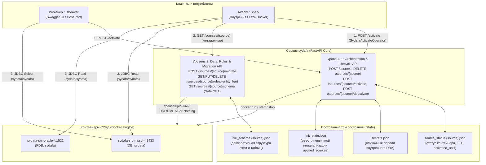

# sydafa

**sydafa** (Synthetic Data Factory & DB Orchestrator) — автономный сервис для оркестрации реляционных СУБД-источников, декларативного управления схемами данных и генерации синтетических данных.

Сервис предназначен для изолированного тестирования ETL/ELT-пайплайнов (Spark, Airflow, dbt), озер данных (Iceberg, Delta Lake) и витрин данных без необходимости ручного развертывания и ручного наполнения тестовых реляционных СУБД.

---

## 1. Архитектура и ключевые концепции

Архитектура системы построена на строгом разграничении привилегий, изоляции уровней и выносе состояния в постоянный том:



### 1.1. Двухуровневая модель API

- **Уровень 1: Orchestration & Lifecycle API (Инфраструктура)**:
  - Управляет жизненным циклом контейнеров Docker, именованными томами данных и сетевыми портами.
  - Однократно выполняет вендорный bootstrap СУБД под системным администратором (`sa` в MSSQL, `SYS as SYSDBA` в Oracle): создает рабочую базу/PDB `sydafa`, настраивает учетные записи, после чего навсегда отключает системный `sa` (`ALTER LOGIN [sa] DISABLE`) и удаляет `pdbadmin`.
  - Генерирует случайные пароли внутреннего DBA (`_sydafa_admin_*`), сохраняя их исключительно в `/state/secrets.json`.

- **Уровень 2: Data, Rules & Migration API (Данные, правила и транзакции)**:
  - Отвечает за создание схем и таблиц, транзакционную эволюцию структуры и синтетическое наполнение строк.
  - Работает исключительно внутри базы `sydafa` под сгенерированным внутренним DBA. У него нет и не должно быть доступа к Docker Socket или к мастер-базам сервера (`master`, `FREE`).
  - Все операции DDL + DML выполняются атомарно (All-or-Nothing) в рамках единой транзакции СУБД через `POST /sources/{source}/migrate`.

### 1.2. Принцип безопасных GET-ручек (RFC 7231 Safe Methods)

Состояние сервиса полностью отделено от контейнеров СУБД и хранится в постоянном томе `/state`:
- `live_schema.{source}.json` — актуальная live-структура схем, таблиц, типов колонок, первичных и внешних ключей.
- `source_status.{source}.json` — текущий статус жизненного цикла (`idle`, `starting`, `running`), отметка `activated_until` (в ISO 8601 UTC) и параметры подключения.
- `init_state.json` — реестр статуса первичной инициализации источников: `{"applied_sources": {"<source>": "<timestamp>"}}`. Записи ведутся индивидуально по каждому источнику.
- `secrets.json` — учетные данные внутренних администраторов баз.

> **Важный архитектурный принцип: Safe GET**
> 
> По стандарту RFC 7231 методы `GET` (`GET /sources/{source}`, `GET /sources/{source}/schema`, `GET /sources/{source}/status`, `GET /sources/{source}/rules`, `GET /health`) являются **безопасными и идемпотентными**. Они считывают метаданные и структуру исключительно из тома `/state` и памяти сервиса. 
> 
> **Вызов GET-запроса никогда не будит контейнер с СУБД и не расходует оперативную память хоста.** Для физического запуска контейнера используется строго явный метод `POST /sources/{source}/activate` или транзакционный `POST /sources/{source}/migrate`.

### 1.3. Модель доступа и безопасность

| Учетная запись | Логин | Пароль | Роль и привилегии | Назначение |
| :--- | :--- | :--- | :--- | :--- |
| **Публичный читатель** | `sydafa` | `sydafa` | Только чтение: `SELECT` + `SELECT ANY DICTIONARY` (Oracle, для мониторинга сессий `v$session`) | Spark, Airflow, Trino, DBeaver |
| **Внутренний DBA** | Случайный (напр. `_sydafa_admin_3f2a`) | Случайный | DBA внутри базы `sydafa` | **Только ядро sydafa** (скрыт в `/state/secrets.json`) |
| **Вендорные админы** | `sa`, `pdbadmin` | — | Заблокированы | `sa` отключен (`DISABLE`), `pdbadmin` удален |

- Имя рабочей базы данных / Service Name: **`sydafa`**.
- Единые реквизиты читателя для любых пайплайнов и DBeaver: логин **`sydafa`**, пароль **`sydafa`**.
- Изменить структуру базы напрямую через DBeaver или Spark невозможно: учетная запись читателя имеет права строго на чтение (`SELECT`). В Oracle читателю дополнительно выдан `SELECT ANY DICTIONARY` — читать словарь (`v$session` и др.) можно, изменять что-либо по-прежнему нет.

### 1.4. Сетевая модель и порты

Каждый инстанс СУБД получает стандартизированное сетевое имя по строгой маске:
`sydafa-[<префикс>-]src-<тип СУБД>-<имя инстанса>`

Имя тома данных СУБД формируется аналогично:
`sydafa-[<префикс>-]data-<тип СУБД>-<имя инстанса>`

- **Внутренние порты в Docker**: внутри Docker-сети каждый контейнер представляет собой отдельный виртуальный хост:
  - Oracle слушает стандартный порт **`1521`** (DNS: `sydafa-src-oracle-<имя>:1521`);
  - MSSQL слушает стандартный порт **`1433`** (DNS: `sydafa-src-mssql-<имя>:1433`).
- **Внешние порты на хост-машине (`external_port`)**: для прямого доступа к базам из DBeaver порт хоста объявляется прямо в манифесте `sources.json`. Если `external_port` опущен или равен `null`, внешний порт не открывается, и база изолирована внутри Docker-сети.

---

## 2. Декларативный манифест `sources.json`

Файл `sources.json` монтируется в контейнер sydafa (`/app/config/sources.json:ro`) и является **главным источником правды** для топологии баз, внешних портов, декларативной структуры таблиц и начальных правил генерации данных:

```json
{
  "sources": {
    "billing": {
      "type": "mssql",
      "external_port": 14330,
      "schema": {
        "tables": {
          "demo.customers": {
            "primary_key": [
              "customer_id"
            ],
            "columns": {
              "customer_id": { "type": "bigint" },
              "name": { "type": "string" },
              "segment": { "type": "string" }
            },
            "foreign_keys": []
          }
        }
      },
      "rules": {
        "demo.customers": {
          "columns": {
            "customer_id": {
              "kind": "sequence"
            },
            "name": {
              "kind": "faker",
              "provider": "company"
            },
            "segment": {
              "kind": "choice",
              "values": [
                "Retail",
                "Corporate",
                "VIP"
              ]
            }
          }
        }
      }
    },
    "crm": {
      "type": "oracle",
      "external_port": 15211,
      "schema": {
        "tables": {}
      },
      "rules": {}
    }
  }
}
```

### Семантика манифеста:
1. **Статичная топология и внешние порты**: состав источников и их внешние порты хоста (`external_port`) объявляются декларативно.
2. **Бесшовная смена внешнего порта**: при изменении `external_port` в `sources.json` и перезапуске sydafa (`docker compose restart sydafa`) сервис пересоздаст контейнер СУБД с новым портом на хосте, **полностью сохранив все таблицы и данные в томе данных (`volume`)**.
3. **Чистые таблицы и регистрация правил**: при первом старте неинициализированного источника sydafa поднимает его СУБД, транслирует блок `schema` в DDL-команды создания чистых схем и таблиц с учетом Foreign Keys, регистрирует профили правил из блока `rules` и **немедленно останавливает СУБД (`docker stop`)**, возвращая 0 MB RAM. Наполнение данными осуществляется через метод `POST /sources/{source}/migrate`. Если источник уже инициализирован, контейнер СУБД на старте не запускается.
4. **Добавление нового источника**: просто допишите новый объект в `sources.json` и перезапустите сервис. Sydafa инициализирует только новый источник, не затрагивая уже существующие базы.
5. **Самоочистка (Self-Healing)**: если том `/state` был удален, но старые контейнеры СУБД или тома данных остались, sydafa на старте автоматически очищает осиротевшие ресурсы своего префикса и разворачивает чистое окружение.

---

## 3. Быстрый старт и развертывание

### Очистка динамических источников в Docker Compose

При запуске sydafa внутри Compose динамические контейнеры наследуют проект
родителя и получают служебные метки Compose, включая `config-hash`. Поэтому
`docker compose down --remove-orphans` удаляет и контейнеры источников, сохраняя
именованные тома данных. Самостоятельный запуск через `docker run` не назначает
источникам принадлежность к Compose-проекту.

Для полного сброса через `docker compose down --remove-orphans --volumes`
каждый том источника необходимо объявить в Compose с точным `name` (например,
`sydafa-data-mssql-bank`) и подключить к сервису sydafa в отдельную директорию
(например, `/source-volumes/bank`), чтобы Compose включил том в модель проекта.
Данные СУБД sydafa по-прежнему монтирует в контейнер источника. Одних меток тома
недостаточно для его удаления Compose. `/reinit` и self-healing очищают содержимое
томов, подключённых под `/source-volumes/`, не удаляя сам подключённый том.
Состав томов нужно синхронизировать с
`sources.json`; при нескольких проектах используйте разные `SYDAFA_CONTAINER_PREFIX`.

Не используйте `docker compose up --remove-orphans`: источники являются orphan
сервисами и будут удалены. Обычный запуск — `docker compose up -d`.
Интеграция проверяется тестом `test/test_compose_cleanup.py` на установленной
версии Compose. Уже созданные старой версией контейнеры не получают новые метки
автоматически: удалите их однократно вручную, сохранив тома, если нужны данные.

### 3.1. Раздельный запуск: sydafa и стенд КХД в двух Docker Compose

Если вы запускаете `sydafa` автономно (или на выделенном сервере):

**Проект 1: Автономная sydafa (`docker-compose.sydafa.yaml`)**
```yaml
name: sydafa-standalone

services:
  sydafa:
    image: ghcr.io/georgekochergin/sydafa:latest
    environment:
      - SYDAFA_MAX_TTL_MINUTES=30
      - SYDAFA_TTL_MINUTES=15
    volumes:
      - /var/run/docker.sock:/var/run/docker.sock
      - ./conf/sydafa/sources.json:/app/config/sources.json:ro
      - sydafa_state:/state
    ports:
      - "8090:8000"
    networks:
      - sydafa-net

volumes:
  sydafa_state:

networks:
  sydafa-net:
```

**Проект 2: Стенд КХД (потребители данных)**
В стенде потребителей Spark и Airflow настраиваются на сетевой адрес sydafa:
```yaml
services:
  spark-master:
    environment:
      - MSSQL_HOST=host.docker.internal
      - MSSQL_PORT=14330
      - ORACLE_HOST=host.docker.internal
      - ORACLE_PORT=15211
      - SYDAFA_URL=http://host.docker.internal:8090
    extra_hosts:
      - "host.docker.internal:host-gateway"
```

### 3.2. Параллельный запуск нескольких экземпляров sydafa

Для запуска двух или более независимых стендов `sydafa` на одном Docker-хосте ресурсы экземпляров изолируются:
1. **Префикс контейнеров и томов (`SYDAFA_CONTAINER_PREFIX`)**: задается уникальным для каждого экземпляра (`inst1`, `inst2`). Контейнеры и тома СУБД получают префиксы `sydafa-inst1-...` и `sydafa-inst2-...`.
2. **Том состояния (`/state`)**: у каждого экземпляра должен быть свой volume (`sydafa_state_1` и `sydafa_state_2`).
3. **Порт API sydafa на хосте**: задаются разными (например, `8091` и `8092`).
4. **Внешние порты СУБД (`external_port`)**: уникальные порты в конфигурационных файлах.

---

## 4. Жизненный цикл инстансов (Честный TTL) и подключение СУБД

Контейнеры СУБД поднимаются строго по требованию (Lazy Start) и не расходуют память хоста в простое.

### 4.1. Механизм TTL и автоматическая остановка
- При обращении к `POST /sources/{name}/activate?ttl_minutes=15` контейнер СУБД просыпается (`docker start`), проверяется доступность порта и фиксируется время окончания активности `activated_until`.
- Дефолтное время жизни настраивается переменной `SYDAFA_TTL_MINUTES` (по умолчанию **15 минут**).
- Максимальный лимит настраивается переменной `SYDAFA_MAX_TTL_MINUTES` (по умолчанию **30 минут**).
- **Логика капинга**: если запросить `ttl_minutes` больше максимального лимита (например, 45 минут при максимуме 30), время жизни ограничивается максимальным лимитом (30 минут).
- **Честная остановка фоновым демоном `_idle_watcher`**: демон каждые 10 секунд проверяет статус. По истечении `activated_until` контейнер принудительно останавливается (`docker stop`), высвобождая оперативную память, даже если в DBeaver или Spark осталось открытое соединение.
- **Нейтрализация несанкционированного ручного запуска**: если контейнер СУБД запущен на хосте вручную (`docker start <container>` в терминале или кнопкой старта в интерфейсе Docker Desktop) без активной сессии API sydafa, демон `_idle_watcher` обнаруживает запущенный контейнер без активного статуса и TTL (`activated_until`) и **немедленно принудительно останавливает его**, предотвращая несанкционированное потребление оперативной памяти хоста.

### 4.2. Подключение из DBeaver через Swagger UI

1. Откройте в браузере Swagger UI: `http://localhost:<порт-sydafa>/docs`.
2. Вызовите метод `POST /sources/{source}/activate?ttl_minutes=15`.
3. В ответе сервера вернется статус готовности и объект `connection`:
   ```json
   {
     "source": "billing",
     "state": "running",
     "last_used": "2026-10-14T12:00:00Z",
     "activated_until": "2026-10-14T12:15:00Z",
     "ttl_minutes": 15,
     "connection": {
       "type": "mssql",
       "host": "localhost",
       "port": 14330,
       "database": "sydafa",
       "user": "sydafa",
       "password": "sydafa",
       "jdbc_url": "jdbc:sqlserver://localhost:14330;databaseName=sydafa;trustServerCertificate=true;encrypt=false"
     },
     "host_port": 14330,
     "published": true
   }
   ```
   > Поле `activated_until` всегда возвращается в формате **ISO 8601 UTC** (`Z`). Все необходимые параметры подключения уже включены в готовую строку `jdbc_url`.
4. В DBeaver создайте подключение:
   - Host: `localhost`
   - Port: порт из ответа (напр. `14330` для MSSQL или `15211` для Oracle)
   - Database / Service Name: `sydafa`
   - Username: `sydafa`, Password: `sydafa`
   - Для MSSQL: во вкладке *Driver Properties* включите `trustServerCertificate=true`.

### 4.3. Точечная реинициализация источника (`POST /sources/{source}/reinit`)

Когда разработчик меняет состав колонок, таблиц или правил в блоках `schema` или `rules` файла `sources.json` для **конкретного источника** (например, `billing`), нет необходимости перезапускать весь compose-стек или сбрасывать все базы:
1. Отредактируйте `sources.json` для нужной базы.
2. Вызовите метод `POST /sources/{source}/reinit`.
3. Sydafa автоматически и изолированно:
   - Остановит и удалит контейнер и именованный том данных именно этого источника;
   - Очистит live-схему `/state/live_schema.{source}.json`, реестр правил и статус источника;
   - Сбросит отметку источника в `/state/init_state.json`;
   - Поднимет чистую СУБД, развернет свежую схему и сохранит правила из `sources.json`;
   - Немедленно остановит СУБД для освобождения памяти хоста (0 MB RAM).
4. Все остальные источники продолжают работать без изменений.

> **Миграция на квотированные идентификаторы Oracle**: Oracle-источники, инициализированные до перехода на строгий нижний регистр (когда таблицы создавались в верхнем регистре `TRADING_CORE.ACCOUNTS`), после обновления сервиса требуют однократного `POST /sources/{source}/reinit` — сервис обратится к таблицам по новым квотированным именам в нижнем регистре. Источники MSSQL миграции не требуют (регистр там нечувствителен и не менялся).

---

## 5. Справочник REST API

Интерактивная документация Swagger UI доступна по адресу: `http://localhost:<порт-sydafa>/docs`.

| Метод | Путь | Назначение |
| :--- | :--- | :--- |
| `GET` | `/health` | Готовность сервиса sydafa к обработке запросов (`ok`), список активных источников и временная метка `initialized_at` (ISO 8601 UTC). Во время первичного развертывания возвращает 503 (`initializing`). |
| `GET` | `/sources` | Список зарегистрированных источников из манифеста `sources.json` (Safe GET из памяти). |
| `GET` | `/sources/{source}` | Метаданные источника: тип СУБД, имя БД, логин читателя, объект `connection` и плоский список таблиц (`TableRef {schema, name}`). Safe GET, не будит базу. |
| `GET` | `/sources/{source}/status` | Текущий статус контейнера (`idle`, `running`), срок TTL и реквизиты `connection`. Safe GET. |
| `POST` | `/sources/{source}/activate` | Физический запуск СУБД в Docker и продление срока жизни (`?ttl_minutes=15`). |
| `POST` | `/sources/{source}/deactivate` | Принудительная остановка базы для освобождения RAM хоста. |
| `POST` | `/sources/{source}/reinit` | Точечная реинициализация источника из `sources.json` с пересозданием тома данных. |
| `GET` | `/sources/{source}/rules` | Список всех зарегистрированных профилей правил генерации для источника (`TableRuleProfile`). Safe GET. |
| `GET` | `/sources/{source}/rules/{entity_fqn}` | Профиль правил генерации конкретной таблицы (`columns` + `invariants`). Safe GET. |
| `PUT` | `/sources/{source}/rules/{entity_fqn}` | Установка или обновление профиля правил генерации для таблицы (`columns` и/или `invariants`). Опциональный query-параметр `?validate_existing=false` (мягкий режим; при `true` — строгая проверка данных в СУБД с ошибкой 422). |
| `PUT` | `/sources/{source}/rules/{entity_fqn}/columns/{column}` | Точечное назначение или замена генератора **одной колонки** (`GeneratorSpec` в теле); остальной профиль не затрагивается. |
| `DELETE` | `/sources/{source}/rules/{entity_fqn}/columns/{column}` | Точечное удаление правила генерации одной колонки. |
| `POST` | `/sources/{source}/rules/{entity_fqn}/invariants` | Добавление **одного инварианта связности** к профилю таблицы. Дубликат того же инварианта отклоняется с `409`. Поддерживает `?validate_existing=true`. |
| `DELETE` | `/sources/{source}/rules/{entity_fqn}/invariants/{index}` | Удаление инварианта по его позиции (индексу) в списке `invariants`. |
| `DELETE` | `/sources/{source}/rules/{entity_fqn}` | Сброс правил генерации таблицы. |
| `GET` | `/sources/{source}/schema` | Детальная live-схема данных: структура таблиц, типы колонок, первичные и внешние ключи. Safe GET. |
| `POST` | `/sources/{source}/migrate` | **Единый метод миграций**: атомарное применение DDL (схемы, таблицы, колонки) и DML (`truncate`, `append`, `update`, `delete`) в режиме All-or-Nothing. |

---

## 6. Профили правил генерации данных и инварианты (Rules API)

В sydafa физическая структура реляционных таблиц отделена от бизнес-логики синтетической генерации данных:
- Физическая схема (`TableSchema`) хранит только реляционную модель СУБД (`name`, `type`, `primary_key`, `foreign_keys`).
- Бизнес-профиль таблицы (`TableRuleProfile`) управляет синтетическим наполнением (`columns`) и инвариантами связности строк (`invariants`).

> **Инварианты связности данных** (см. [Раздел 6.4: Инварианты связности данных](#64-инварианты-связности-данных)) — это декларативные правила согласованности, накладываемые на совокупность строк таблицы (партицию). В отличие от генераторов колонок, вычисляющих изолированные значения внутри одной записи, инварианты задают условия, которым должен удовлетворять весь набор строк сущности как единое целое (накопительные итоги, агрегатные соотношения, цепочки состояний).

### 6.1. Управление профилями через `/sources/{source}/rules/{entity_fqn}`

Эндпоинт `PUT /sources/{source}/rules/{entity_fqn}` принимает полный профиль таблицы:
```json
{
  "columns": {
    "status": {
      "kind": "choice",
      "values": ["NEW", "PROCESSING", "DONE"]
    }
  },
  "invariants": [
    {
      "kind": "cumulative_balance",
      "partition_by": ["account_id"],
      "amount_column": "amount"
    }
  ]
}
```

Через этот эндпоинт можно:
1. **Настроить генераторы колонок таблицы** (передав словарь `columns`);
2. **Настроить инварианты таблицы** (передав список `invariants`);
3. **Обновить профиль целиком**, объединяя генераторы колонок и инварианты связности.

> `PUT` **перезаписывает профиль целиком** — ключи, забытые в теле, будут удалены. Для точечных правок без пересылки всего профиля используйте вложенные эндпоинты:

**Точечная замена генератора одной колонки** — `PUT /sources/{source}/rules/{entity_fqn}/columns/{column}` (назначение или замена; остальной профиль не меняется):

```bash
curl -X PUT "http://localhost:8090/sources/bank/rules/retail_bank.clients/columns/email" \
  -H "Content-Type: application/json" \
  -d '{"kind": "faker", "provider": "email", "null_ratio": 0.05}'
```

**Точечное удаление правила колонки** (например, после переименования или удаления колонки на источнике) — `DELETE /sources/{source}/rules/{entity_fqn}/columns/{column}`.

**Добавление одного инварианта связности** — `POST /sources/{source}/rules/{entity_fqn}/invariants`:

```json
{
  "kind": "cumulative_balance",
  "amount_column": "amount",
  "partition_by": ["account_id"],
  "min_balance": 0.0
}
```

Повторная регистрация того же инварианта отклоняется с `409 Conflict`. Удаление инварианта — `DELETE /sources/{source}/rules/{entity_fqn}/invariants/{index}`, где `{index}` — позиция в списке `invariants` профиля (порядок виден в `GET` того же профиля).

### 6.2. Справочник логических типов данных СУБД (`type`)

При создании таблиц и добавлении колонок используются унифицированные платформонезависимые типы данных:

| Логический тип | MSSQL | Oracle | Описание |
| :--- | :--- | :--- | :--- |
| `bigint` | `BIGINT` | `NUMBER(19)` | 64-битное целое число (счетчики, первичные ключи) |
| `string` | `NVARCHAR(400)` | `VARCHAR2(400)` | Юникод-строка фиксированной максимальной длины |
| `decimal(p,s)` | `DECIMAL(p,s)` | `NUMBER(p,s)` | Точное десятичное число с точностью `p` и масштабом `s` |
| `date` | `DATE` | `DATE` | Календарная дата без времени |
| `timestamp` | `DATETIME2` | `TIMESTAMP` | Дата и точное время с долями секунд |

### 6.2.1. Регистр идентификаторов в Oracle (точное соответствие спецификации)

Все идентификаторы (схемы/пользователи, таблицы, колонки, констрейнты) создаются сервисом в **квотированном виде**, поэтому имена в СУБД хранятся **ровно в том регистре, в котором они объявлены в `sources.json` или в операциях `/migrate`** (по соглашению — в нижнем):

- в Oracle DDL всегда генерируется с двойными кавычками: `CREATE TABLE "retail_bank"."accounts" (...)` — без квотирования Oracle нормализовал бы имена в верхний регистр (`RETAIL_BANK.ACCOUNTS`);
- в MSSQL используются квадратные скобки `[schema].[table]` (регистр в MSSQL нечувствителен к регистру и сохраняется как есть);
- технические объекты (`_upd_*`, `_del_*`, `_batch_id`, `_exec_batch_id`) создаются по тем же правилам.

Внешним потребителям (Spark, Airflow, Trino, DBeaver) при прямых SQL-запросах к Oracle следует обращаться к объектам в квотированном нижнем регистре (например, `SELECT * FROM "trading_core"."accounts"`); JDBC-каталоги и инструменты с интроспекцией метаданных возвращают имена в нижнем регистре без дополнительных настроек.

### 6.3. Справочник генераторов данных колонок (`columns`)

Генераторы задаются в словаре `columns` профиля таблицы:

| `kind` | Параметры | Описание |
| :--- | :--- | :--- |
| `sequence` | — | Строго монотонный автоинкрементный счетчик целых чисел (`1, 2, 3...`). Состояние персистентно сохраняется в `/state/sequences.{source}.json`, стартует с 0 (первое значение 1), выделяется диапазонами на батч и **никогда не уменьшается и не откатывается** при `delete` или `truncate` (гарантирует отсутствие повторного использования старых ключей). Работает автономно в памяти сервиса без SQL-запросов `SELECT MAX` к таблицам БД. Поддерживается для первичных ключей (`primary_key`) и произвольных колонок |
| `uuid` | — | Уникальный идентификатор UUIDv4 (строка вида `xxxxxxxx-xxxx-4xxx-yxxx-xxxxxxxxxxxx`). Подходит для одиночных или составных первичных ключей и строковых колонок |
| `faker` | `provider`: `"name"` \| `"company"` \| `"word"` \| `"address"` \| `"email"`, `locale`: `"ru_RU"` | Реалистичные синтетические строки через библиотеку Faker |
| `choice` | `values`: `["A", "B", "C"]`, `weights`: `[0.7, 0.2, 0.1]` | Случайный выбор из списка значений (равновероятный или взвешенный) |
| `random_decimal` | `min`: `10.0`, `max`: `5000.0` | Случайное число с плавающей точкой в диапазоне |
| `random_date` | `anchor`: `"start_of_year"` (дефолт) \| `"today"` \| `"start_of_quarter"` \| `"start_of_month"` \| `"end_of_year"`, `dim`: `"y"` \| `"m"` \| `"d"`, `min_offset`, `max_offset` | По умолчанию дата строго в пределах текущего календарного года. С параметрами — смещение от опорной точки |
| `date_offset` | `ref_column`: `"contract_start_date"`, `dim`: `"y"` \| `"m"` \| `"d"`, `min_offset`: `1`, `max_offset`: `5` | Дата со смещением относительно другой колонки строки. Независима от физического порядка колонок (автоматический DAG) |

> **Доля NULL-значений (`null_ratio`):** Для любого генератора поддерживается опциональный параметр `null_ratio` от `0.0` до `1.0` (например, `null_ratio: 0.3` = 30% сгенерированных значений будут `NULL`).
> 
> Если для колонки генератор не указан явно, движок генерирует синтетическое значение по умолчанию на основе ее реляционного типа.
>
> **Правила первичных ключей (`primary_key`):**
> Для гарантии уникальности строк без накладных расходов на чтение таблиц:
> - Одиночный `primary_key` обязан содержать явный уникальный генератор (`sequence` или `uuid`). Неявные умолчания (fallback) по типу колонки отсутствуют — генератор объявляется явно.
> - Составной `primary_key` обязан содержать **как минимум одну** колонку с явным уникальным генератором (`sequence` или `uuid`), либо полностью состоять из колонок `foreign_keys` (связующие таблицы many-to-many).

### 6.4. Инварианты связности данных

**Инварианты связности данных** — это декларативные правила согласованности, накладываемые на совокупность строк таблицы (партицию). В отличие от генераторов колонок, вычисляющих изолированные значения внутри одной записи, инварианты задают условия, которым должен удовлетворять весь набор строк сущности как единое целое (накопительные итоги, агрегатные соотношения, цепочки состояний).

#### 6.4.1. Общий атрибут всех инвариантов: `validate_existing: bool = False`

Каждый поддерживаемый инвариант таблицы включает в себя обязательный базовый параметр `validate_existing`, определяющий режим его применения и строгости:

- **`validate_existing: false` (по умолчанию — мягкий режим)**:
  - **Регистрация без запуска СУБД (Safe Register, 0 MB RAM)**: вызов `PUT /sources/{source}/rules/{entity_fqn}` регистрирует профиль правил в состоянии `/state` без проверки существующих строк и не запускает спящий контейнер СУБД.
  - **Свободные мутации для тестирования**: операции `update` и `delete` не блокируются, позволяя инженерам КХД и ETL моделировать тестовые аномалии и граничные ситуации (например, технический овердрафт или сбой биллинга).
  - **`append` как умный балансировщик**: движок при генерации новых строк считывает текущее агрегатное состояние из БД и автоматически генерирует компенсирующие значения (например, только пополнения `CREDIT`), возвращая набор строк сущности в согласованную зону.
- **`validate_existing: true` (строгий режим)**:
  - **Предварительная проверка данных**: исторические строки в СУБД проверяются при регистрации правила через `PUT /rules`; при наличии нарушений регистрация отклоняется с ошибкой `422 Unprocessable Entity`.
  - **Invariant Guard в миграциях**: любые операции `update` и `delete` в `POST /sources/{source}/migrate`, нарушающие логику инварианта на данных СУБД, приводят к немедленному откату всей транзакции (`ROLLBACK`) с ошибкой 422.

#### 6.4.2. Накопительный баланс (`cumulative_balance`)

Первым встроенным инвариантом связности является накопительный баланс (`kind: "cumulative_balance"`). Он применяется к финансовым операциям, транзакциям и выпискам по счетам и гарантирует, что накопленный агрегатный итог (`SUM(amount)`) никогда не опустится ниже заданного минимума (`min_balance`).

Если параметр `partition_by` не указан или передан пустым списком `[]`, баланс рассчитывается **глобально для всей таблицы** (например, для единой кассы или общего пула средств). При указании списка колонок (например, `["account_id"]` или `["client_id", "currency"]`) баланс отслеживается раздельно для каждой партиции.

Сумма транзакции (`amount_column`) записывается со знаком: операции пополнения генерируются с положительным значением (`+amt`), а операции списания — с отрицательным (`-amt`), что обеспечивает естественную согласованность с SQL-агрегацией `SUM(amount)`.

##### Полный список параметров `cumulative_balance`:

| Параметр | Тип | По умолчанию | Описание |
| :--- | :--- | :--- | :--- |
| `kind` | `string` | `"cumulative_balance"` | Идентификатор типа правила. |
| `amount_column` | `str` | Обязательно | Имя числовой колонки суммы транзакции (дельты остатка). |
| `partition_by` | `list[str]` | `[]` | Опциональный список колонок разреза/лицевого счета (например `["account_id"]` или `["client_id", "currency"]`). Если не указан, баланс считается глобально по таблице. |
| `min_balance` | `float` | `0.0` | Минимальный допустимый баланс (`0.0` — неотрицательный остаток; отрицательное число задает лимит овердрафта). |
| `initial_balance` | `float` | `0.0` | Начальный виртуальный баланс для нового счета/пула, если по нему еще нет истории в таблице. |
| `deposit_prob` | `float` | `0.5` | Вероятность генерации пополнения (от 0.0 до 1.0) при наличии достаточного остатка для списания. При балансе <= `min_balance` генератор форсирует 100% пополнений. |
| `deposit_range` | `[min, max]` | `[10.0, 1000.0]` | Диапазон сумм операции пополнения. |
| `withdrawal_range` | `[min, max]` | `[10.0, 1000.0]` | Диапазон сумм операции списания (фактическая сумма автоматически ограничивается доступным остатком). |
| `validate_existing` | `bool` | `false` | Режим проверки: при `false` (мягкий режим) мутации свободны, а `append` балансирует остаток; при `true` (строгий режим) любые нарушения инварианта блокируются с ошибкой 422. |

##### Пример 1: Накопительный баланс с разрезом по счетам (`partition_by`)
```json
{
  "kind": "cumulative_balance",
  "partition_by": ["account_id"],
  "amount_column": "amount",
  "min_balance": 0.0,
  "deposit_prob": 0.6,
  "deposit_range": [100.0, 5000.0],
  "withdrawal_range": [50.0, 2000.0]
}
```

##### Пример 2: Глобальный баланс по всей таблице (без partition_by)
Баланс единой кассы или корпоративного фонда без деления на лицевые счета:
```json
{
  "kind": "cumulative_balance",
  "amount_column": "tx_amount",
  "min_balance": 0.0,
  "deposit_range": [500.0, 10000.0],
  "withdrawal_range": [100.0, 3000.0]
}
```

### 6.5. Разрешение зависимостей между колонками (DAG-генерация)

В sydafa генераторы колонок могут зависеть друг от друга (например, дата окончания договора должна быть позже даты начала). Движок автоматически строит направленный ациклический граф зависимостей (DAG) и вычисляет значения в топологическом порядке, **независимо от физического порядка колонок в таблице**.

**Шаг 1. Создание таблицы через DDL (`POST /sources/{source}/migrate`):**
```json
{
  "operations": [
    {
      "op": "create_table",
      "entity_fqn": "demo.contracts",
      "primary_key": ["contract_id"],
      "columns": [
        {"name": "contract_id", "type": "bigint"},
        {"name": "contract_end_date", "type": "date"},
        {"name": "contract_start_date", "type": "date"}
      ]
    }
  ]
}
```
*(Обратите внимание: физически колонка `contract_end_date` создана раньше `contract_start_date`)*.

**Шаг 2. Настройка правил генерации (`PUT /sources/{source}/rules/demo.contracts`):**
```json
{
  "columns": {
    "contract_id": {
      "kind": "sequence"
    },
    "contract_start_date": {
      "kind": "random_date",
      "anchor": "start_of_year"
    },
    "contract_end_date": {
      "kind": "date_offset",
      "ref_column": "contract_start_date",
      "dim": "y",
      "min_offset": 1,
      "max_offset": 3
    }
  }
}
```

**Шаг 3. Генерация данных (`POST /sources/{source}/migrate`):**
```json
{
  "operations": [
    {
      "op": "append",
      "entity_fqn": "demo.contracts",
      "rows": 10
    }
  ]
}
```
При выполнении операции `append` движок анализирует зависимость: `contract_end_date` ссылается на `contract_start_date`. Движок сначала вычисляет случайную дату начала, а затем добавляет к ней смещение от 1 до 3 лет, гарантируя корректность временного интервала для каждой сгенерированной строки.

---

## 7. Транзакционная эволюция схем и управление данными (`POST /sources/{source}/migrate`)

Метод `POST /sources/{source}/migrate` объединяет DDL и DML в единую транзакцию All-or-Nothing.

### 7.1. Единый FQN-идентификатор сущности (`entity_fqn`)

Все операции над сущностями адресуются через единый атрибут:
`entity_fqn: "<схема>.<таблица>"` (например, `"demo.orders"` или `"core.contracts"`). В секции `foreign_keys` внешние связи ссылаются на целевую сущность через единый атрибут `ref_entity_fqn: "<схема>.<таблица>"`.

### 7.2. Справочник DDL-операций (10 операций)

#### `create_schema`
Создание новой схемы в базе данных:
```json
{
  "op": "create_schema",
  "name": "demo"
}
```

#### `drop_schema`
Удаление пустой схемы:
```json
{
  "op": "drop_schema",
  "name": "demo"
}
```

#### `rename_schema`
Переименование схемы с переносом всех существующих таблиц в целевую схему:
```json
{
  "op": "rename_schema",
  "from_name": "demo",
  "to_name": "core"
}
```

#### `create_table`
Создание таблицы с первичным ключом, колонками и внешними ключами:
```json
{
  "op": "create_table",
  "entity_fqn": "demo.orders",
  "primary_key": ["order_id"],
  "columns": [
    {"name": "order_id", "type": "bigint", "generator": {"kind": "sequence"}},
    {"name": "customer_id"},
    {"name": "amount", "type": "decimal(18,2)"},
    {"name": "order_date", "type": "date"}
  ],
  "foreign_keys": [
    {
      "columns": ["customer_id"],
      "ref_entity_fqn": "demo.customers",
      "ref_columns": ["customer_id"]
    }
  ]
}
```
> **Автоматическое наследование типов для Foreign Key (`foreign_keys`):**
> - Колонки, входящие в `foreign_keys` (например, `customer_id`), наследуют точный тип данных из родительской таблицы (`demo.customers.customer_id`).
> - Для FK-колонок поле `type` в `columns` можно не указывать. Если тип указан, он принудительно заменяется типом родительской колонки.
> - Порядок колонок в массиве `columns` строго определяет физический порядок колонок (`ORDINAL_POSITION`) при создании таблицы в СУБД.
> - Не-FK колонки обязаны содержать явный `type`. В `sources.json` секция `columns` задаётся словарём словарей (`"columns": { "customer_id": {}, "amount": {"type": "decimal(18,2)"} }`).

#### `drop_table`
Удаление таблицы из схемы:
```json
{
  "op": "drop_table",
  "entity_fqn": "demo.orders"
}
```

#### `rename_table`
Переименование таблицы внутри схемы:
```json
{
  "op": "rename_table",
  "entity_fqn": "demo.orders",
  "to_name": "client_orders"
}
```

#### `transfer_table`
Перенос таблицы между существующими схемами:
```json
{
  "op": "transfer_table",
  "entity_fqn": "demo.orders",
  "to_schema": "core"
}
```

#### `add_column`
Добавление новой колонки в таблицу:
```json
{
  "op": "add_column",
  "entity_fqn": "demo.orders",
  "column": {
    "name": "status",
    "type": "string"
  }
}
```

#### `drop_column`
Удаление колонки из таблицы (запрещено удалять колонки первичного ключа):
```json
{
  "op": "drop_column",
  "entity_fqn": "demo.orders",
  "name": "status"
}
```

#### `rename_column`
Переименование колонки (если колонка входит в состав Primary Key, имя ключа обновляется автоматически):
```json
{
  "op": "rename_column",
  "entity_fqn": "demo.orders",
  "from_name": "status",
  "to_name": "order_status"
}
```

---

### 7.3. Справочник DML-операций (4 операции)

#### `truncate`
Очистка таблицы от данных с опциональным каскадным удалением по внешним ключам (`cascade: true`):
```json
{
  "op": "truncate",
  "entity_fqn": "demo.orders",
  "cascade": true
}
```

#### `append`
Генерация и вставка синтетических строк на основе сконфигурированных правил:
```json
{
  "op": "append",
  "entity_fqn": "demo.orders",
  "rows": 50
}
```
- `rows` (int, от 1 до 100 000): количество вставляемых строк.

##### Механика связей по Foreign Key:
1. **Строгая ссылочная целостность (Strict FK Integrity)**:
   - Значения колонок, входящих в `foreign_keys`, выбираются исключительно случайным образом из уже существующих строк родительской таблицы (`random.choice(existing_parent_pks)`).
   - Вставка в дочернюю таблицу никогда не создаёт неявных строк в родительских таблицах (отсутствие скрытых сайд-эффектов).
2. **Контроль порядка наполнения**:
   - Если родительская таблица **пуста**, операция `append` в дочернюю таблицу немедленно отклоняется с ошибкой `409 Conflict` (`"ForeignKeyViolation: Таблица 'child' ссылается на 'parent' через Foreign Key, но родительская таблица пуста"`). Сначала требуется наполнить родительский справочник.
3. **Профили правил**:
   - Для колонок, входящих в `foreign_keys`, в секции `rules.columns` не требуется указывать генераторы — они автоматически заполняются значениями ключей родителя.

#### `update`
Параметризованное обновление строк по предикату и/или ограничению количества строк:
```json
{
  "op": "update",
  "entity_fqn": "demo.orders",
  "predicate": [
    {"column": "order_id", "operator": "=", "value": 1}
  ],
  "set": {
    "status": "PAID"
  },
  "limit": 10
}
```
- `entity_fqn` (строка, обязательно): полное имя сущности (`schema.table`);
- `set` (объект, обязательно): обновляемые колонки и их значения (системные колонки `_batch_id` и `_exec_batch_id` защищены: `_batch_id` обновляется актуальным батчем автоматически);
- `predicate` (массив условий, опционально, по умолчанию `[]`): операторы `=`, `!=`, `>`, `<`, `>=`, `<=`. При пустом предикате операция применяется ко всем строкам таблицы;
- `limit` (целое число > 0, опционально): ограничение «обновить не более N случайных строк, удовлетворяющих предикату». Механизм полностью PK-независим (работает для heap-таблиц и дубликатов). Снимки строк ДО обновления архивируются в таблицу `_upd_<table>`.

Пример обновления 10 случайных строк таблицы без предиката:
```json
{
  "op": "update",
  "entity_fqn": "demo.orders",
  "set": {
    "status": "CANCELLED"
  },
  "limit": 10
}
```

#### `delete`
Параметризованное удаление строк по предикату и/или ограничению количества строк:
```json
{
  "op": "delete",
  "entity_fqn": "demo.orders",
  "predicate": [
    {"column": "order_id", "operator": ">=", "value": 100}
  ],
  "limit": 5,
  "cascade": false
}
```
- `entity_fqn` (строка, обязательно): полное имя сущности (`schema.table`);
- `predicate` (массив условий, опционально, по умолчанию `[]`): список условий фильтрации;
- `limit` (целое число > 0, опционально): удалить не более N случайных строк, удовлетворяющих предикату. Если подходящих строк меньше N, удаляются все найденные строки без ошибок. Удаляемые строки сохраняются в таблицу аудита `_del_<table>`;
- `cascade` (bool, по умолчанию `false`): каскадное удаление зависимых строк во внешних таблицах по Foreign Key.

Пример удаления 5 случайных строк без предиката:
```json
{
  "op": "delete",
  "entity_fqn": "demo.orders",
  "limit": 5
}
```

---

### 7.4. Правила составления пакета операций

1. **Регулярные выражения имен**: Все идентификаторы (схемы, таблицы, колонки) должны удовлетворять шаблону `^[A-Za-z_][A-Za-z0-9_]*$`.
2. **Транзакционность All-or-Nothing**: Все операции выполняются последовательно в единой транзакции СУБД. При ошибке на любом шаге выполняется полный `ROLLBACK` всех изменений и восстановление схемы в памяти.
3. **Любое чередование DDL и DML**: В одном пакете можно создавать таблицы, добавлять колонки, наполнять строки через `append`, обновлять через `update` и очищать через `truncate`.
4. **Автоматическое разрешение FK**: При вставке строк через `append` sydafa автоматически разрешает внешние ключи, связывая дочерние таблицы с существующими строками родительских таблиц.

---

## 8. Интеграционный слой для Apache Airflow (`sydafa-airflow`)

Для оркестрации эмулятора sydafa в пайплайнах Apache Airflow разработан переиспользуемый пакет **`sydafa-airflow`** (директория [`integrations/airflow`](integrations/airflow)).

Пакет предоставляет хук `SydafaHook` и 3 Airflow-оператора:
- **`SydafaActivateOperator`**: явный Lazy Start и продление TTL СУБД перед чтением;
- **`SydafaMigrateOperator`**: атомарная эволюция схем DDL и синтетическая генерация DML;
- **`SydafaDeactivateOperator`**: принудительная остановка базы для освобождения RAM хоста.

### 8.1. Установка в сторонних проектах
```text
git+https://github.com/georgekochergin/sydafa.git#subdirectory=integrations/airflow
```

### 8.2. Обязательный параметр `conn_id`
Все операторы и хук требуют обязательного указания идентификатора Airflow Connection (`conn_id`). Регистрация подключения:
- **Переменная окружения**: `AIRFLOW_CONN_SYDAFA_DEFAULT='http://sydafa:8000'`
- **CLI**: `airflow connections add sydafa_default --conn-type http --conn-host http://sydafa:8000`
- **UI**: Admin -> Connections -> Add (Id: `sydafa_default`, Type: `HTTP`, Host: `http://sydafa:8000`)

### 8.3. Пример использования в DAG
```python
from sydafa_airflow.operators import (
    SydafaActivateOperator,
    SydafaMigrateOperator,
    SydafaDeactivateOperator,
)

activate = SydafaActivateOperator(
    task_id="activate_source",
    conn_id="sydafa_default",
    source="mssql",
    ttl_minutes=15,
)

migrate = SydafaMigrateOperator(
    task_id="seed_data",
    conn_id="sydafa_default",
    source="mssql",
    operations=[
        {"op": "append", "entity_fqn": "demo.orders", "rows": 50},
    ],
)

deactivate = SydafaDeactivateOperator(
    task_id="stop_source",
    conn_id="sydafa_default",
    source="mssql",
)

activate >> migrate >> deactivate
```

Подробная документация приведена в [integrations/airflow/README.md](integrations/airflow/README.md).

---

## 9. Тестирование и верификация

1. **Локальный запуск модульных тестов**:
   ```bash
   STATE_DIR=$(mktemp -d) .venv/bin/python -m unittest discover -s test -p 'test_*.py'
   ```
2. **Сборка Docker-образа и запуск тестов внутри контейнера**:
   ```bash
   docker build -t sydafa:latest .
   ```
3. **Сквозное e2e-тестирование сервиса в Docker (MSSQL и Oracle)**:
   ```bash
   ./test/test.sh
   ```
4. **Сквозная проверка интеграции со стендом КХД (Spark, Airflow, Trino, Nessie)**:
   ```bash
   /Users/admin/git/datalake_stand/test/test.sh
   ```
