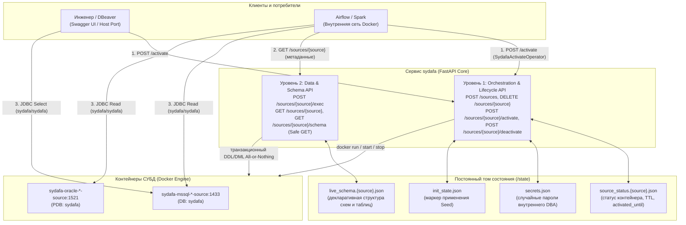

# sydafa

**sydafa** (Synthetic Data Factory & DB Orchestrator) — автономный сервис для оркестрации реляционных СУБД-источников, декларативного управления схемами данных и генерации синтетических данных.

Сервис предназначен для изолированного тестирования ETL/ELT-пайплайнов (Spark, Airflow, dbt), озер данных (Iceberg, Delta Lake) и витрин данных без необходимости ручного развертывания и ручного наполнения тестовых реляционных СУБД.

---

## 1. Архитектура: разделение уровней и хранилище состояния

Архитектура системы построена на строгом разграничении привилегий, изоляции уровней и выносе состояния в постоянный том:



### 1. Уровень 1: Orchestration & Lifecycle API (Инфраструктура)
- Управляет жизненным циклом контейнеров Docker, именованными томами данных и сетевыми портами.
- Однократно выполняет вендорный bootstrap СУБД под системным администратором (`sa` в MSSQL, `SYS as SYSDBA` в Oracle): создает рабочую базу/PDB `sydafa`, настраивает учетные записи, после чего навсегда отключает системный `sa` (`ALTER LOGIN [sa] DISABLE`) и удаляет `pdbadmin`.
- Генерирует случайные пароли внутреннего DBA (`_sydafa_admin_*`), сохраняя их исключительно в `/state/secrets.json`.

### 2. Уровень 2: Data & Schema API (Данные и транзакции)
- Отвечает за создание таблиц, миграции структуры и генерацию строк.
- Работает исключительно внутри базы `sydafa` под сгенерированным внутренним DBA. У него нет и не должно быть доступа к Docker Socket или к мастер-базам сервера (`master`, `FREE`).
- Все операции DDL + DML выполняются атомарно (All-or-Nothing) в рамках единой транзакции СУБД.

### 3. Хранилище состояния (`/state`) и принцип безопасных GET-ручек (RFC 7231 Safe Methods)
Состояние сервиса полностью отделено от контейнеров СУБД и хранится в постоянном томе `/state`:
- `live_schema.{source}.json` — полное декларативное описание таблиц, типов колонок, генераторов значений и ключей.
- `source_status.{source}.json` — текущий статус жизненного цикла (`idle`, `starting`, `running`), отметка `activated_until` (в ISO 8601 UTC) и параметры подключения.
- `init_state.json` — флаг фиксации применения начального манифеста `init.json`.
- `secrets.json` — учетные данные внутренних администраторов баз.

> **Важный архитектурный принцип: Safe GET**
> 
> По стандарту RFC 7231 методы `GET` (`GET /sources/{source}`, `GET /sources/{source}/schema`, `GET /sources/{source}/status`, `GET /health`) являются **безопасными и идемпотентными**. Они считывают метаданные и структуру исключительно из тома `/state` и памяти сервиса. 
> 
> **Вызов GET-запроса никогда не будит контейнер с СУБД и не расходует память хоста.** Для физического запуска контейнера используется строго явный метод `POST /sources/{source}/activate` или `POST /sources/{source}/exec`.

---

## 2. Модель доступа и безопасность

| Учетная запись | Логин | Пароль | Роль и привилегии | Назначение |
| :--- | :--- | :--- | :--- | :--- |
| **Публичный читатель** | `sydafa` | `sydafa` | Только чтение (`SELECT`) | Spark, Airflow, Trino, DBeaver |
| **Внутренний DBA** | Случайный (напр. `_sydafa_admin_3f2a`) | Случайный | DBA внутри базы `sydafa` | **Только ядро sydafa** (скрыт в `/state/secrets.json`) |
| **Вендорные админы** | `sa`, `pdbadmin` | — | Заблокированы | `sa` отключен (`DISABLE`), `pdbadmin` удален |

- Имя рабочей базы данных / Service Name: **`sydafa`**.
- Единые реквизиты читателя для любых пайплайнов и DBeaver: логин **`sydafa`**, пароль **`sydafa`**.
- Изменить структуру базы напрямую через DBeaver или Spark невозможно: учетная запись читателя имеет права строго на чтение (`SELECT`).

---

## 3. Сетевая модель и порты

### Именование контейнеров и DNS
Каждый инстанс получает стандартизированное сетевое имя по строгой маске:
`sydafa-<тип СУБД>-<имя инстанса>-source`

Примеры:
- Инстанс `billing` типа `mssql` -> `sydafa-mssql-billing-source`
- Инстанс `crm` типа `oracle` -> `sydafa-oracle-crm-source`
- В тестовом контуре добавляется изолирующий префикс: `sydafa-test-mssql-billing-source`.

### Внутренние порты в Docker
Внутри Docker-сети каждый контейнер представляет собой отдельный виртуальный хост:
- Контейнеры Oracle слушают стандартный внутренний порт **`1521`**.
- Контейнеры MSSQL слушают стандартный внутренний порт **`1433`**.
Конфликта портов не возникает: сервисы стенда (Spark, Airflow) обращаются к ним по DNS-именам: `sydafa-oracle-crm-source:1521` и `sydafa-mssql-billing-source:1433`.

### Внешние порты на хост-машине (`SYDAFA_EXT_PORT_<NAME>`)
Чтобы открыть доступ к базам из DBeaver на локальной машине, внешние порты хоста задаются индивидуально в переменных окружения сервиса `sydafa` в `docker-compose.yaml`:
```yaml
environment:
  - SYDAFA_EXT_PORT_BILLING=14330   # пробросить на хост порт 14330 для инстанса billing
  - SYDAFA_EXT_PORT_CRM=15211       # пробросить на хост порт 15211 для инстанса crm
```
Если для инстанса переменная не задана, внешний порт не открывается, и база работает изолированно внутри Docker-сети.

---

## 4. Декларативный манифест `init.json` (Seed)

Файл `init.json` монтируется в контейнер sydafa (`/app/config/init.json:ro`) и объявляет состав баз и начальное наполнение:

```json
{
  "sources": {
    "billing": {
      "type": "mssql",
      "operations": [
        {"op": "create_schema", "name": "demo"},
        {
          "op": "create_table",
          "schema": "demo",
          "name": "customers",
          "primary_key": ["customer_id"],
          "columns": [
            {"name": "customer_id", "type": "bigint", "generator": {"kind": "sequence"}},
            {"name": "name", "type": "string", "generator": {"kind": "faker", "provider": "company"}}
          ]
        },
        {"op": "append", "schema": "demo", "table": "customers", "rows": 100}
      ]
    },
    "crm": {
      "type": "oracle",
      "operations": []
    }
  }
}
```

### Семантика начального наполнения (Seed)
1. `init.json` — это **стартовое семя (Seed)** для чистой базы.
2. **Аддитивное поведение**: при первом запуске создаются схемы, таблицы и генерируются начальные строки. При перезапусках сервиса операции не дублируются.
3. **Защита от потери данных**: если из `init.json` удалить описание таблицы, sydafa **никогда не выполняет DROP TABLE** автоматически. Накопленные данные в именованных томах сохраняются.
4. **Сброс с чистого листа**: чтобы пересоздать базы строго по новому `init.json`, выполняется штатный сброс томов Compose: `docker compose down -v`.
5. **Фиксация состояния в `/state/init_state.json`**: после успешного применения `init.json` sydafa записывает флаг `applied: true`. При последующих стартах файл `init.json` полностью игнорируется.
6. **Самоочистка (Self-Healing)**: если том `/state` удален, но старые контейнеры СУБД или тома данных остались, sydafa на старте автоматически удаляет осиротевшие ресурсы и разворачивает чистое окружение.

---

## 5. Жизненный цикл (Честный TTL) и подключение DBeaver

Контейнеры СУБД поднимаются строго по требованию (Lazy Start) и не расходуют память хоста в простое.

### 1. Механизм TTL и автоматическая остановка
- При обращении к `POST /sources/{name}/activate?ttl_minutes=15` контейнер СУБД просыпается (`docker start`), проверяется доступность порта и фиксируется время окончания активности `activated_until`.
- Дефолтное время жизни настраивается переменной `SYDAFA_TTL_MINUTES` (по умолчанию **15 минут**).
- Максимальный лимит настраивается переменной `SYDAFA_MAX_TTL_MINUTES` (по умолчанию **30 минут**).
- **Логика капинга**: если запросить `ttl_minutes` больше максимального лимита (например, 45 минут при максимуме 30), время жизни **ограничивается максимальным лимитом (30 минут)**. Значение по умолчанию (15 минут) устанавливается, только если параметр не передан или передан `<= 0`.
- **Честная остановка**: фоновый демон `_idle_watcher` каждые 10 секунд проверяет статус. По истечении `activated_until` контейнер принудительно останавливается (`docker stop`), высвобождая оперативную память, даже если в DBeaver осталось открытое окно соединения.

### 2. Подключение из DBeaver через Swagger UI

Пользователь взаимодействует с API через веб-интерфейс Swagger UI:

1. Откройте в браузере Swagger UI: `http://localhost:<порт-sydafa>/docs` (например, `http://localhost:8090/docs`).
2. В секции **Lifecycle API** разверните метод `POST /sources/{source}/activate` и нажмите кнопку **Try it out**.
3. Введите параметры:
   - `source`: имя источника (например, `billing` или `mssql`);
   - `ttl_minutes`: желаемое время жизни в минутах (например, `15`).
4. Нажмите **Execute**.
5. В ответе сервера вернется статус готовности и объект `connection`:
   ```json
   {
     "source": "billing",
     "state": "running",
     "last_used": "2026-10-14T12:00:00Z",
     "activated_until": "2026-10-14T12:15:00Z",
     "ttl_minutes": 15,
     "connection": {
       "type": "mssql",
       "host": "localhost",
       "port": 14330,
       "database": "sydafa",
       "user": "sydafa",
       "password": "sydafa",
       "jdbc_url": "jdbc:sqlserver://localhost:14330;databaseName=sydafa;trustServerCertificate=true;encrypt=false"
     },
     "host_port": 14330,
     "published": true
   }
   ```
   > Поле `activated_until` всегда возвращается в стандарте **ISO 8601 UTC** (суффикс `Z`). Все необходимые параметры подключения уже включены в готовую строку `jdbc_url`.
6. В DBeaver создайте новое подключение к БД:
   - Host: `localhost`
   - Port: порт из ответа (например, `14330` для MSSQL или `15211` для Oracle)
   - Database / Service Name: `sydafa`
   - Username: `sydafa`
   - Password: `sydafa`
   - Для MSSQL: во вкладке *Driver Properties* включите `trustServerCertificate=true`.

---

## 6. Раздельный запуск: sydafa и стенд КХД в двух Docker Compose

Если вы хотите запускать `sydafa` автономно (или на выделенном сервере):

### Проект 1: Автономная sydafa (`docker-compose.sydafa.yaml`)
```yaml
name: sydafa-standalone

services:
  sydafa:
    image: ghcr.io/georgekochergin/sydafa:latest
    environment:
      - SYDAFA_MAX_TTL_MINUTES=30
      - SYDAFA_TTL_MINUTES=15
      - SYDAFA_EXT_PORT_BILLING=14330
      - SYDAFA_EXT_PORT_CRM=15211
    volumes:
      - /var/run/docker.sock:/var/run/docker.sock
      - ./conf/sydafa/init.json:/app/config/init.json:ro
      - sydafa_state:/state
    ports:
      - "8090:8000"
    networks:
      - sydafa-net

volumes:
  sydafa_state:

networks:
  sydafa-net:
```

### Проект 2: Стенд КХД (потребители данных)
В стенде потребителей Spark и Airflow настраиваются на сетевой адрес sydafa:
```yaml
services:
  spark-master:
    environment:
      - MSSQL_HOST=host.docker.internal
      - MSSQL_PORT=14330
      - ORACLE_HOST=host.docker.internal
      - ORACLE_PORT=15211
      - SYDAFA_URL=http://host.docker.internal:8090
    extra_hosts:
      - "host.docker.internal:host-gateway"
```

---

## 7. Справочник REST API

Интерактивный Swagger UI доступен по адресу: `http://localhost:<порт-sydafa>/docs`.

### 1. Оркестрация источников (Orchestration API)
| Метод | Путь | Описание | Пример тела |
| :--- | :--- | :--- | :--- |
| `GET` | `/sources` | Список зарегистрированных источников (безопасный запрос из памяти) | — |
| `POST` | `/sources` | Динамическая регистрация нового инстанса СУБД | `{"name": "crm", "type": "oracle"}` |
| `DELETE` | `/sources/{name}` | Остановка контейнера и удаление инстанса | — |

### 2. Жизненный цикл инстанса (Lifecycle API)
| Метод | Путь | Описание | Параметры query |
| :--- | :--- | :--- | :--- |
| `GET` | `/sources/{source}/status` | Текущий статус, срок TTL и реквизиты `connection` (безопасный запрос) | — |
| `POST` | `/sources/{source}/activate` | Физический запуск СУБД в Docker и продление срока жизни | `?ttl_minutes=15` |
| `POST` | `/sources/{source}/deactivate` | Принудительная остановка базы для освобождения RAM | — |

### 3. Данные и схемы (Data & Schema API)
| Метод | Путь | Описание | Пример тела |
| :--- | :--- | :--- | :--- |
| `GET` | `/health` | Готовность сервиса sydafa к обработке запросов | — |
| `GET` | `/sources/{source}` | **Метаданные источника и инфраструктура**: тип СУБД, имя БД, логин читателя, объект `connection` и плоский список имен зарегистрированных таблиц (`TableRef {schema, name}`) без детального описания колонок. Безопасный запрос, не будит базу. | — |
| `GET` | `/sources/{source}/schema` | **Детальная live-схема данных**: полное декларативное описание структуры таблиц, колонок с их типами данных, генераторами значений, первичными и внешними ключами. Безопасный запрос, читает файл `/state/live_schema.{source}.json`. | — |
| `POST` | `/sources/{source}/exec` | Единый транзакционный метод применения изменений структуры (DDL: схемы, таблицы, колонки, трансфер) и данных (DML: append, update, delete, truncate) в режиме All-or-Nothing. Будит базу при необходимости. | `{"operations": [...]}` |

---

## 8. Единый метод исполнения: `POST /sources/{source}/exec`

В архитектуре **sydafa** управление структурой базы данных (DDL) и генерацией данных (DML) не разбивается на множество разрозненных REST-эндпоинтов (нет необходимости вызывать отдельные HTTP-ручки для добавления колонки, удаления таблицы или вставки строк). 

Вместо этого используется **единая точка транзакционного управления**: метод `POST /sources/{source}/exec`.

### Преимущества единого метода
1. **Транзакционность All-or-Nothing**: Все операции из массива `operations` выполняются строго последовательно в рамках **одной транзакции СУБД**. Если любая операция падает (ошибка синтаксиса, нарушение ограничений FK/PK или типа данных), СУБД автоматически выполняет полный `ROLLBACK`, а состояние схемы сервиса восстанавливается до исходного.
2. **Атомарные миграции со сгенерированными данными**: В одном запросе можно создать схему, таблицу, добавить колонку, сгенерировать 1000 строк и выполнить точечный update.
3. **Единый источник правды**: Вся эволюция фиксируется в декларативном состоянии `live_schema.{source}.json`.

---

### Справочник логических типов данных (`type`)

При создании таблиц и добавлении колонок используются унифицированные платформонезависимые типы данных, которые транслируются движком в нативные типы MSSQL и Oracle:

| Логический тип | MSSQL | Oracle | Описание |
| :--- | :--- | :--- | :--- |
| `bigint` | `BIGINT` | `NUMBER(19)` | 64-битное целое число (счетчики, первичные ключи) |
| `string` | `NVARCHAR(400)` | `VARCHAR2(400)` | Юникод-строка фиксированной максимальной длины |
| `decimal(p,s)` | `DECIMAL(p,s)` | `NUMBER(p,s)` | Точное десятичное число с точностью `p` и масштабом `s` |
| `date` | `DATE` | `DATE` | Календарная дата без времени |
| `timestamp` | `DATETIME2` | `TIMESTAMP` | Дата и точное время с долями секунд |

---

### Справочник генераторов данных (`generator`)

В объекте колонки поле `generator` определяет синтетическое наполнение при выполнении операции `append`:

| `kind` | Дополнительные параметры | Описание и пример |
| :--- | :--- | :--- |
| `sequence` | — | Автоинкрементный счетчик целых чисел (`1, 2, 3...`) |
| `faker` | `provider`: `"company"` \| `"name"` \| `"word"` \| `"address"` \| `"email"` | Синтетические реалистичные строки соответствующего профиля Faker |
| `choice` | `values`: `["Retail", "Corporate", "VIP"]` | Случайный выбор одного значения из переданного списка |
| `random_decimal` | `min`: `10.0`, `max`: `5000.0` | Случайное число с плавающей точкой в заданном диапазоне |
| `random_date` | — | Случайная дата в пределах текущего и прошедшего года |

> Если у колонки генератор не указан (`null`), при `append` в нее вставляется значение `NULL`.

---

### Поддерживаемые операции (14 операций)

#### 1. Операции эволюции схемы (DDL — 10 операций)

##### `create_schema`
Создание новой схемы в базе данных:
```json
{
  "op": "create_schema",
  "name": "demo"
}
```

##### `drop_schema`
Удаление пустой схемы. Если в схеме присутствуют таблицы, операция завершится ошибкой валидации:
```json
{
  "op": "drop_schema",
  "name": "demo"
}
```

##### `rename_schema`
Переименование схемы с автоматическим переносом всех существующих в ней таблиц в целевую схему:
```json
{
  "op": "rename_schema",
  "from_name": "demo",
  "to_name": "core"
}
```

##### `create_table`
Создание таблицы с описанием первичного ключа, колонок, генераторов и внешних ключей:
```json
{
  "op": "create_table",
  "schema": "demo",
  "name": "orders",
  "primary_key": ["order_id"],
  "columns": [
    {"name": "order_id", "type": "bigint", "generator": {"kind": "sequence"}},
    {"name": "customer_id", "type": "bigint", "generator": {"kind": "sequence"}},
    {"name": "amount", "type": "decimal(18,2)", "generator": {"kind": "random_decimal", "min": 10, "max": 5000}},
    {"name": "order_date", "type": "date", "generator": {"kind": "random_date"}}
  ],
  "foreign_keys": [
    {
      "columns": ["customer_id"],
      "ref_schema": "demo",
      "ref_table": "customers",
      "ref_columns": ["customer_id"]
    }
  ]
}
```

##### `drop_table`
Удаление таблицы из схемы (с каскадным снятием зависимостей внешних ключей):
```json
{
  "op": "drop_table",
  "schema": "demo",
  "name": "orders"
}
```

##### `rename_table`
Переименование таблицы внутри схемы:
```json
{
  "op": "rename_table",
  "schema": "demo",
  "from_name": "orders",
  "to_name": "client_orders"
}
```

##### `transfer_table`
Перенос таблицы между существующими схемами:
```json
{
  "op": "transfer_table",
  "table": "orders",
  "from_schema": "demo",
  "to_schema": "core"
}
```

##### `add_column`
Добавление новой колонки в существующую таблицу:
```json
{
  "op": "add_column",
  "schema": "demo",
  "table": "orders",
  "column": {
    "name": "status",
    "type": "string",
    "generator": {
      "kind": "choice",
      "values": ["NEW", "PAID", "CANCELLED"]
    }
  }
}
```

##### `drop_column`
Удаление колонки из таблицы (запрещено удалять колонки, входящие в Primary Key):
```json
{
  "op": "drop_column",
  "schema": "demo",
  "table": "orders",
  "name": "status"
}
```

##### `rename_column`
Переименование колонки в таблице (если колонка входит в состав Primary Key, имя ключа автоматически обновляется):
```json
{
  "op": "rename_column",
  "schema": "demo",
  "table": "orders",
  "from_name": "status",
  "to_name": "order_status"
}
```

---

#### 2. Операции работы с данными (DML — 4 операции)

##### `truncate`
Очистка таблицы от данных с опциональным каскадным удалением по внешним ключам (`cascade: true`):
```json
{
  "op": "truncate",
  "schema": "demo",
  "table": "orders",
  "cascade": true
}
```

##### `append`
Генерация и вставка синтетических строк на основе сконфигурированных генераторов колонок (`rows` от 1 до 100 000; `new_key_ratio` от 0.0 до 1.0 — доля генерации новых значений для FK):
```json
{
  "op": "append",
  "schema": "demo",
  "table": "orders",
  "rows": 50,
  "new_key_ratio": 0.1
}
```

##### `update`
Параметризованное обновление строк по предикату:
```json
{
  "op": "update",
  "schema": "demo",
  "table": "orders",
  "predicate": [
    {"column": "order_id", "operator": "=", "value": 1}
  ],
  "set": {
    "status": "PAID"
  }
}
```
> Допустимые операторы в предикатах: `=`, `!=`, `>`, `<`, `>=`, `<=`.

##### `delete`
Параметризованное удаление строк по предикату:
```json
{
  "op": "delete",
  "schema": "demo",
  "table": "orders",
  "predicate": [
    {"column": "order_id", "operator": "=", "value": 1}
  ],
  "cascade": false
}
```

---

### Правила составления пакета операций

1. **Регулярные выражения имен**: Все идентификаторы (схемы, таблицы, колонки) должны удовлетворять шаблону `^[A-Za-z_][A-Za-z0-9_]*$`.
2. **Порядок следования операций**: Операции создания схемы (`create_schema`) должны предшествовать созданию таблиц в этой схеме (`create_table`), а DDL-операции эволюции должны выполняться до наполнения (`append`) или модификации (`update`/`delete`).
3. **Целостность внешних ключей**: При наполнении связанных таблиц через `append` sydafa автоматически учитывает ссылки `foreign_keys`, подставляя существующие ключи из родительских таблиц.
