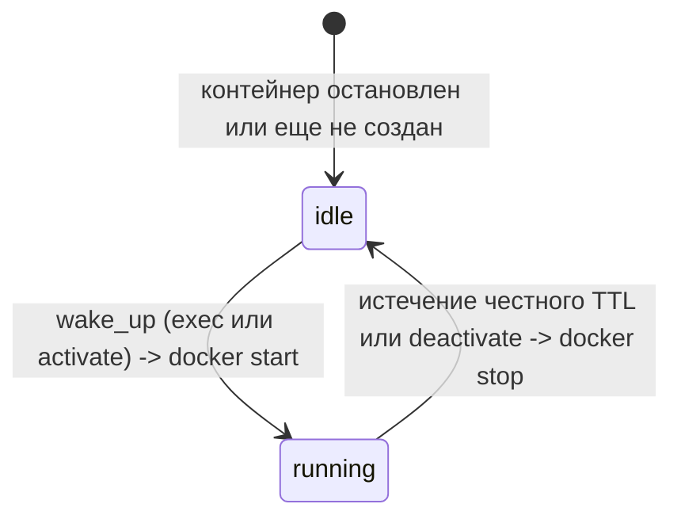

# sydafa

**sydafa** (Synthetic Data Factory & DB Orchestrator) — автономный сервис для оркестрации СУБД-источников, декларативного управления схемами данных и генерации синтетических данных.

Проект разработан для изолированного тестирования ETL/ELT-пайплайнов (Spark, Airflow, dbt), озер данных (Iceberg, Delta Lake) и витрин данных без необходимости ручного развертывания и заполнения тестовых реляционных СУБД.

---

## Архитектура и принципы работы

### Быстрый старт и экономия ресурсов
Сервис `sydafa` запускается мгновенно (за 1-2 секунды). Сами базы данных (MSSQL, Oracle) **не стартуют вместе с сервисом** и не расходуют память компьютера вхолостую. База поднимается автоматически только тогда, когда к ней поступает обращение:
- Неявно при отправке данных или схемы через `POST /sources/{source}/exec`;
- Либо явно через `POST /sources/{source}/activate` (для работы аналитика в DBeaver или перед ETL).

Проверка работоспособности (`GET /health`) подтверждает готовность самого сервиса sydafa принимать команды, поэтому весь стек стенда поднимается без задержек.



### Честное время жизни (TTL) и сохранение данных
- При активации источника устанавливается время активности (по умолчанию **15 минут**).
- Максимальное время настраивается переменной окружения `SYDAFA_MAX_TTL_MINUTES` (по умолчанию **30 минут**). Если запрошено значение больше максимума, автоматически применяется дефолтное значение 15 минут.
- Каждое обращение к API продлевает таймер активности.
- **Честная остановка**: если в течение заданного времени обращений к API не было, фоновый процесс останавливает контейнер (`docker stop`) и освобождает RAM, даже если в DBeaver осталось открытое сетевое окно.
- **Сохранность данных**: все данные и таблицы хранятся в постоянных томах Docker (`sydafa-mssql-data`, `sydafa-oracle-data`). При остановке и повторном пробуждении данные не теряются.

---

## Модель доступа: простота и безопасность

| Учетная запись | Логин | Пароль | Права | Кто использует |
| :--- | :--- | :--- | :--- | :--- |
| **Публичный читатель** | `sydafa` | `sydafa` | Только чтение (`SELECT`) | Spark, Airflow, Trino, DBeaver |
| **Внутренний DBA** | Случайный | Случайный | Полные (sysadmin / DBA) | **Только ядро sydafa** (скрыт в `/state/secrets.json`) |
| **Вендорные админы** | `sa`, `pdbadmin` | — | Отключены / удалены | Заблокированы |

- Имя рабочей базы данных: **`sydafa`**.
- Публичный пользователь для любых проверок и выгрузок: **`sydafa` / `sydafa`**.
- Внести изменения в структуру базы в обход API невозможно: под учеткой `sydafa` доступны только операции чтения, а пароль суперпользователя знает только сам сервис.

---

## Конфигурация источников стенда

Источники объявляются декларативно через единственный файл **`init.json`**:
```json
{
  "sources": {
    "billing": {
      "type": "mssql",
      "operations": [
        {"op": "create_schema", "name": "demo"},
        {
          "op": "create_table",
          "schema": "demo",
          "name": "customers",
          "primary_key": ["customer_id"],
          "columns": [
            {"name": "customer_id", "type": "bigint", "generator": {"kind": "sequence"}},
            {"name": "name", "type": "string", "generator": {"kind": "faker", "provider": "company"}}
          ]
        }
      ]
    },
    "crm": {
      "type": "oracle",
      "operations": []
    }
  }
}
```
- Ключом источника является **произвольное уникальное имя инстанса** (`billing`, `crm`, `erp` и т.д.), что позволяет запускать любое количество инстансов одного типа.
- Если для источника передан пустой список операций (`"operations": []`), `sydafa` разворачивает чистую рабочую базу `sydafa` без создания таблиц.
- Внутренние имена хостов в Docker-сети формируются строго по маске: **`sydafa-<тип>-<имя>-source`** (например, `sydafa-mssql-billing-source`, `sydafa-oracle-crm-source`).
- Стандартные внутренние порты СУБД: MSSQL = `1433`, Oracle = `1521`. Внутри Docker-сети каждый контейнер изолирован и имеет собственный IP, поэтому одинаковый внутренний порт у разных инстансов — норма и стандарт.

### Аддитивный Seed без потери данных
- `init.json` работает как **стартовый набор (Seed)** при рождении базы.
- При перезапусках `sydafa` сопоставляет операции с текущей `live_schema`: если таблица уже есть — она пропускается без ошибок, если в `init.json` добавилась новая таблица — она автоматически создается.
- Удаление таблиц из `init.json` **никогда не приводит к DROP TABLE**. Данные в постоянных томах сохраняются. Для сброса баз «с чистого листа» используется `docker compose down -v`.

---

## Интеграция в Docker Compose

```yaml
services:
  sydafa:
    image: ${SYDAFA_IMAGE:-ghcr.io/georgekochergin/sydafa:latest}
    environment:
      - SYDAFA_MAX_TTL_MINUTES=30
      - SYDAFA_TTL_MINUTES=15
      # Открыть внешние порты на хосте для подключения DBeaver (по имени инстанса):
      - SYDAFA_EXT_PORT_BILLING=14330
      - SYDAFA_EXT_PORT_CRM=15211
    volumes:
      - /var/run/docker.sock:/var/run/docker.sock
      - ./conf/sydafa/init.json:/app/config/init.json:ro
      - sydafa_state:/state
    ports:
      - "8090:8000"
    networks:
      - stand-network

volumes:
  sydafa_state:
```

### Назначение внешних портов (`SYDAFA_EXT_PORT_<NAME>`)
- Внутри Docker-сети сервисы стенда (Spark, Airflow) обращаются к стандартным внутренним портам СУБД (`sydafa-mssql-billing-source:1433`, `sydafa-oracle-crm-source:1521`).
- Переменная `SYDAFA_EXT_PORT_<NAME>` публикует внешний порт на хост-машине (ноутбуке), чтобы к конкретной базе мог подключиться DBeaver. Если переменная для инстанса не задана, внешний порт не открывается.

---

## Как подключиться и работать с источником

### 1. Подключение ETL (Spark, Airflow внутри Docker-сети)
Spark и Airflow подключаются к СУБД напрямую во внутренней сети:
- **MSSQL**: Host `sydafa-mssql-billing-source`, Port `1433`, Database `sydafa`, User `sydafa`, Password `sydafa`.
- **Oracle**: Host `sydafa-oracle-crm-source`, Port `1521`, Service Name `sydafa`, User `sydafa`, Password `sydafa`.

Перед началом объемной выгрузки пайплайн может вызвать `POST /sources/mssql/activate?ttl_minutes=20`, гарантируя бодрствование базы на все время выполнения задачи.

### 2. Инспекция из DBeaver с ноутбука
1. Выполните запрос на активацию:
   ```bash
   curl -X POST "http://localhost:8090/sources/mssql/activate?ttl_minutes=15"
   ```
2. В ответе придут полные реквизиты подключения (`connection`):
   ```json
   {
     "source": "mssql",
     "state": "running",
     "activated_until": "2026-10-13T16:00:00Z",
     "ttl_minutes": 15,
     "connection": {
       "type": "mssql",
       "host": "localhost",
       "port": 14330,
       "database": "sydafa",
       "user": "sydafa",
       "password": "sydafa",
       "parameters": {
         "trustServerCertificate": "true"
       },
       "jdbc_url": "jdbc:sqlserver://localhost:14330;databaseName=sydafa;trustServerCertificate=true;encrypt=false"
     }
   }
   ```
3. В DBeaver создайте постоянное подключение на `localhost:14330` под пользователем `sydafa` / `sydafa` (для MSSQL отметьте флаг *Trust Server Certificate*). База готова к работе.

---

## REST API

Интерактивная документация Swagger UI доступна по адресу: `http://localhost:<порт-sydafa>/docs`.

### 1. Оркестрация источников (Orchestration API)
| Метод | Путь | Назначение |
| :--- | :--- | :--- |
| `GET` | `/sources` | Список зарегистрированных источников |
| `POST` | `/sources` | Динамическая регистрация нового инстанса `{"name": "billing", "type": "mssql"}` |
| `DELETE` | `/sources/{source}` | Остановка контейнера и удаление инстанса |

### 2. Жизненный цикл инстанса (Lifecycle API)
| Метод | Путь | Назначение |
| :--- | :--- | :--- |
| `GET` | `/sources/{source}/status` | Текущий статус, срок TTL и реквизиты подключения `connection` |
| `POST` | `/sources/{source}/activate?ttl_minutes=15` | Пробуждение базы и продление TTL (лимит до 30 мин) |
| `POST` | `/sources/{source}/deactivate` | Принудительная остановка базы для освобождения RAM |

### 3. Данные и схемы (Data & Schema API)
| Метод | Путь | Назначение |
| :--- | :--- | :--- |
| `GET` | `/health` | Готовность сервиса sydafa |
| `GET` | `/sources/{source}` | Метаданные источника, схемы, таблицы и connection |
| `GET` | `/sources/{source}/schema` | Текущая live-схема в JSON |
| `POST` | `/sources/{source}/exec` | Единый транзакционный метод DDL + DML (All-or-Nothing) |

---

## Единый метод исполнения (POST /sources/{source}/exec)

Все операции выполняются в одной транзакции СУБД (All-or-Nothing). При ошибке транзакция откатывается.
Вызов `/exec` автоматически будит источник, если он находился в спящем режиме.

Пример создания структуры и генерации синтетических строк:
```json
{
  "operations": [
    {"op": "create_schema", "name": "demo"},
    {
      "op": "create_table",
      "schema": "demo",
      "name": "customers",
      "primary_key": ["customer_id"],
      "columns": [
        {"name": "customer_id", "type": "bigint", "generator": {"kind": "sequence"}},
        {"name": "name", "type": "string", "generator": {"kind": "faker", "provider": "company"}},
        {"name": "segment", "type": "string", "generator": {"kind": "choice", "values": ["Retail", "Corporate", "VIP"]}}
      ]
    },
    {"op": "append", "schema": "demo", "table": "customers", "rows": 100}
  ]
}
```

---

## Перспективы развития: sydafa как удаленный сервис (Модель Б)

При развитии инфраструктуры `sydafa` может быть вынесена на отдельный постоянный сервер (Data-as-a-Service), обслуживающий сразу несколько удаленных тестовых стендов.

В этом сценарии:
1. **Инициализация по сети**: удаленный стенд передает файл `init.json` через HTTP API вызовом `POST /sources/{source}/exec`, не требуя общего дискового тома.
2. **Внешний доступ**: СУБД слушают внешние фиксированные порты на сервере `sydafa`.
3. **Обнаружение параметров**: удаленный стенд делает `POST /activate` и получает из объекта `connection` точный внешний адрес хоста и порта СУБД для запуска выгрузок Spark/Airflow.
