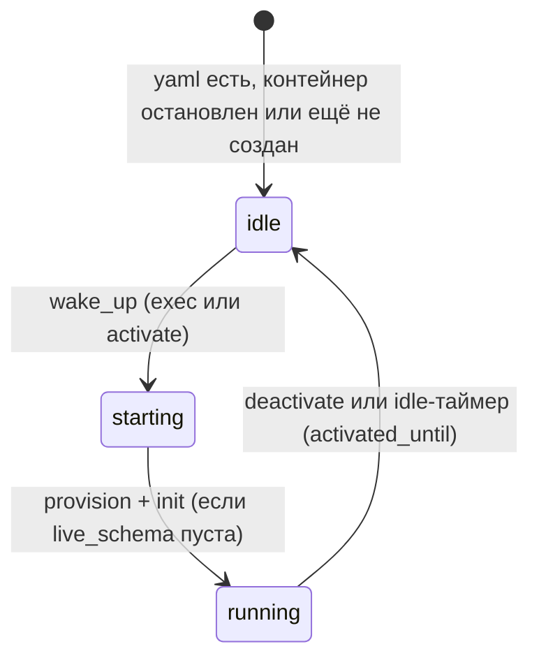

# sydafa

**sydafa** (Synthetic Data Factory & DB Orchestrator) — автономный сервис для оркестрации СУБД-источников, декларативного управления схемами данных и генерации синтетических данных.

Проект разработан для изолированного тестирования ETL/ELT-пайплайнов (Spark, Airflow, dbt), озер данных (Iceberg, Delta Lake) и витрин данных без необходимости ручного развертывания и заполнения тестовых реляционных СУБД.

---

## Архитектура

Источники СУБД **не поднимаются при старте** sydafa. Контейнер источника создаётся (или будится) по требованию: либо неявно при обращении к API данных (`/exec`, `/schema/evolve`, append/update/delete), либо явно через `POST /sources/{source}/activate` (инспекция из DBeaver).



Ключевые компоненты:

| Модуль | Роль |
|---|---|
| `app/secrets.py` | Однократная генерация паролей в `/state/secrets.json` (не логируются, не отдаются API) |
| `app/container_manager.py` | Docker SDK: named volume `{source}-data`, `wake_up` / `deactivate`, публикация host-порта только на activate |
| `app/source_status.py` | Persist `/state/source_status.{source}.json` (`state`, `activated_until`, `host_port`) |
| `app/init_apply.py` | `init.json` применяется **один раз** на источник с пустой `live_schema` |
| `app/provisioning.py` | Идемпотентный bootstrap БД/логинов; `sa` отключается; `pdbadmin` удаляется |
| idle-таймер | Фоновый цикл: при `now > activated_until` вызывает `deactivate` |

Данные строк живут в named volume (`mssql`: `/var/opt/mssql`, `oracle`: `/opt/oracle/oradata`). Описание схемы — в volume `sydafa_state` (`/state`). `stop` и recreate контейнера данные не уничтожают; `docker rm -v` / `compose down -v` — уничтожают.

`GET /health` возвращает 200, когда **сам sydafa** готов (yaml источников прочитан). Готовность конкретной БД — `GET /sources/{source}/status`. Зависимые сервисы в Compose не должны ждать прогрева Oracle через healthcheck sydafa.

---

## Модель доступа (два рабочих аккаунта)

| Аккаунт | Роль | Пароль | Кто подключается |
|---|---|---|---|
| `sydafa` | sysadmin / DBA | случайный, только в `/state/secrets.json` | **только процессы sydafa** (через API) |
| `reader` (имя из `reader:` в yaml) | только чтение | **пароль = имя** | ETL (spark/airflow) и инспекция из DBeaver |

Встроенные админы нейтрализованы: MSSQL `sa` — `ALTER LOGIN [sa] DISABLE`; Oracle `pdbadmin` — `DROP USER`; `SYS`/`SYSTEM` получают случайный пароль (удалить их нельзя — это ядро СУБД).

Схема данных меняется **только через API**. Ручной DDL из DBeaver под `sydafa` невозможен: пароль сервису известен, человеку — нет. Обратная синхронизация ручных изменений в `live_schema` не поддерживается.

---

## Возможности

- **Ленивая оркестрация контейнеров СУБД** через Docker Python SDK, штатные образы вендоров.
- **Однократный `init.json`**: на первом `wake_up` пустого источника создаются схемы/таблицы; повторный старт не пытается пересоздать существующее.
- **Единый транзакционный `POST /sources/{source}/exec`**: DDL + DML, All-or-Nothing.
- **Lifecycle API**: `status` / `activate` / `deactivate` — отдельная группа ручек от данных.
- DDL: `create_schema`, `drop_schema`, `rename_schema`, `create_table`, `drop_table`, `rename_table`, `transfer_table`, `add_column`, `drop_column`, `rename_column`.
- DML: `truncate`, `append`, `update`, `delete` (FK-aware, генераторы `sequence` / `faker` / `choice` / `random_decimal` / `random_date`).

---

## Интеграция в сторонние проекты

### 1. Подключение в `docker-compose.yaml`

```yaml
services:
  sydafa:
    image: ${SYDAFA_IMAGE:-ghcr.io/georgekochergin/sydafa:latest}
    volumes:
      - /var/run/docker.sock:/var/run/docker.sock
      - ./sydafa:/app/config:ro
      - sydafa_state:/state
    ports:
      - "8090:8000"
    networks:
      - <network-name>

volumes:
  sydafa_state:

networks:
  <network-name>:
```

> 1. **HEALTHCHECK** встроен в образ (опрос `/health`). Для зависимых сервисов: `depends_on: { sydafa: { condition: service_healthy } }` — это готовность API, не прогрев MSSQL/Oracle.
> 2. Пароли `sa`/`SYS`/`sydafa` генерируются внутри сервиса. Их не нужно (и нельзя) задавать в compose.
> 3. Нужен Docker Socket: sydafa оркестрирует контейнеры источников в сети проекта.
> 4. Host-порты источников **не** публикуются в compose — их выдаёт `POST /activate`.

Переменная `SYDAFA_CONTAINER_PREFIX` (опционально) префиксирует имена контейнеров и volume источников, чтобы тестовый прогон не пересекался с живым стендом.

### 2. Конфигурация источников и `init.json`

В смонтированной директории:

- `sources/*.yaml` — по файлу на источник. Поле `port:` — **внутренний** порт СУБД (контракт docker-сети), не host-порт.
- `init.json` (опционально) — начальная раскладка. Применяется **один раз**, когда `live_schema` источника пуста.

```yaml
# sources/mssql.yaml
type: mssql
host: mssql-source
port: 1433
reader: reader
```

```json
{
  "sources": {
    "mssql": [
      {"op": "create_schema", "name": "demo"},
      {
        "op": "create_table",
        "schema": "demo",
        "name": "customers",
        "primary_key": ["customer_id"],
        "columns": [
          {"name": "customer_id", "type": "bigint", "generator": {"kind": "sequence"}},
          {"name": "name", "type": "string", "generator": {"kind": "faker", "provider": "company"}}
        ]
      }
    ]
  }
}
```

Добавление источника на **живом** стенде: положить новый `sources/oracle.yaml`, при необходимости дописать блок в `init.json`, перезапустить **только** сервис sydafa (`docker compose up -d sydafa`). Не запускать `test.sh` и не делать `down -v`. После первого обращения/activate oracle получит init; mssql с непустой `live_schema` init пропустит.

### 3. Подключение ETL (чтение)

ETL ходит **внутри docker-сети** на `host:port` из yaml под `reader` / `reader` (или другим именем из поля `reader`):

- MSSQL: Host `mssql-source`, Port `1433`, Database `sydafa`, User/Password `reader`/`reader`.
- Oracle: Host `oracle-source`, Port `1521`, Service Name `sydafa`, User/Password `reader`/`reader`.

### 4. Инспекция из DBeaver (чтение)

Прямого `localhost:1433` нет, пока источник не активирован.

1. `POST http://localhost:<sydafa-port>/sources/{source}/activate?ttl_minutes=15`
2. Из JSON-ответа взять `host_port`.
3. В DBeaver:
   - **MSSQL**: Host `localhost`, Port = `host_port`, Database `sydafa`, User `reader`, Password `reader`.
   - **Oracle**: Host `localhost`, Port = `host_port`, Service name `sydafa`, User `reader`, Password `reader`.
4. По истечении `ttl_minutes` без обращений к API контейнер останавливается, DBeaver-сессия обрывается. Продлить: снова `activate` или любой `/exec`.

### 5. Очистка в CI

Тестовый прогон должен использовать `SYDAFA_CONTAINER_PREFIX` и удалять **только** свои контейнеры/volume:

```bash
docker rm -f sydafa-test-mssql-source sydafa-test-oracle-source >/dev/null 2>&1 || true
```

Не вызывать `docker rm -f mssql-source oracle-source`, если параллельно крутится живой стенд.

---

## REST API

Swagger UI: `http://localhost:<host-порт-sydafa>/docs` (host-порт из compose, не хардкодить).

### Жизненный цикл источника

| Метод | Путь | Назначение |
| --- | --- | --- |
| GET | `/sources/{source}/status` | `{state, last_used, activated_until, ttl_minutes, host_port, published}` |
| POST | `/sources/{source}/activate?ttl_minutes=15` | Разбудить + опубликовать host-порт; в ответе `host_port` |
| POST | `/sources/{source}/deactivate` | Остановить контейнер, снять публикацию |

### Данные и схема

| Метод | Путь | Назначение | Тело |
| --- | --- | --- | --- |
| GET | `/health` | Готовность API sydafa | — |
| GET | `/sources` | Список источников из yaml | — |
| GET | `/sources/{source}` | Реквизиты, reader, список схем/таблиц | — |
| GET | `/sources/{source}/schema` | live-схема JSON | — |
| GET | `/tables/{source}/{schema}/{table}` | Спецификация таблицы | — |
| POST | `/sources/{source}/exec` | Транзакционный DDL+DML | `{"operations": [...]}` |

Ручки данных **неявно** вызывают `wake_up` (без публикации host-порта). Это не HTTP-вызов `activate`.

---

## Единый метод исполнения (POST /sources/{source}/exec)

Все операции в одной транзакции СУБД. Ошибка → ROLLBACK, HTTP 422 (409 при конфликте FK).

### DDL
- `create_schema`: `{"op": "create_schema", "name": "demo"}`
- `create_table`:
  ```json
  {
    "op": "create_table",
    "schema": "demo",
    "name": "customers",
    "primary_key": ["customer_id"],
    "columns": [
      {"name": "customer_id", "type": "bigint", "generator": {"kind": "sequence"}},
      {"name": "name", "type": "string", "generator": {"kind": "faker", "provider": "company"}},
      {"name": "segment", "type": "string", "generator": {"kind": "choice", "values": ["Retail", "Corporate", "VIP"]}}
    ],
    "foreign_keys": []
  }
  ```
- `add_column`: `{"op": "add_column", "schema": "demo", "table": "customers", "column": {"name": "discount", "type": "decimal(5,2)"}}`
- `rename_column` / `drop_column` / `rename_table` / `drop_table` / `transfer_table` / `rename_schema` / `drop_schema` — см. скилл `.agents/skills/sydafa-api/SKILL.md`.

### DML
- `truncate`: `{"op": "truncate", "schema": "demo", "table": "orders", "cascade": true}`
- `append`: `{"op": "append", "schema": "demo", "table": "customers", "rows": 10, "new_key_ratio": 0.0}`
- `update` / `delete` — предикат `{"column","operator","value"}`, операторы `= != > < >= <=`.

---

## Поддерживаемые типы данных

| Логический тип | MSSQL DDL | Oracle DDL | Spark/Iceberg тип |
|---|---|---|---|
| `bigint` | `BIGINT` | `NUMBER(19)` | `long` |
| `string` | `NVARCHAR(400)` | `VARCHAR2(400)` | `string` |
| `decimal(p,s)` | `DECIMAL(p,s)` | `NUMBER(p,s)` | `decimal(p,s)` |
| `date` | `DATE` | `DATE` | `date` |
| `timestamp` | `DATETIME2` | `TIMESTAMP` | `timestamp` |

---

## Тестирование

1. **Unit-тесты (сборка образа):**
   ```bash
   docker build -t sydafa:latest .
   ```
2. **e2e (MSSQL, затем Oracle):**
   ```bash
   ./test/test.sh --e2e
   ./test/test.sh
   ./test/test.sh --source mssql
   ```
   e2e задаёт `SYDAFA_CONTAINER_PREFIX=sydafa-test-` и чистит только префиксные контейнеры/volume.
